<p align="center">
  <a href="#english"><b>🇬🇧 English</b></a> • <a href="#italiano"><b>🇮🇹 Italiano</b></a>
</p>

---

<a name="english"></a>

# CyberNeon — Netrunner theme for Ubuntu Budgie

> **Note (Fan Project):** CyberNeon is an unofficial, non-commercial fan project created out of love for *Cyberpunk 2077*. The visual style it draws inspiration from, the name *Cyberpunk 2077*, and the *Arasaka* logo included in the repository (`assets/logo/`) are trademarks and exclusive property of **CD PROJEKT S.A.** This project is not affiliated with, sponsored, or endorsed by CD PROJEKT RED (see [Credits & Licenses](#credits-trademarks-and-licenses) and [`NOTICE.md`](NOTICE.md)).

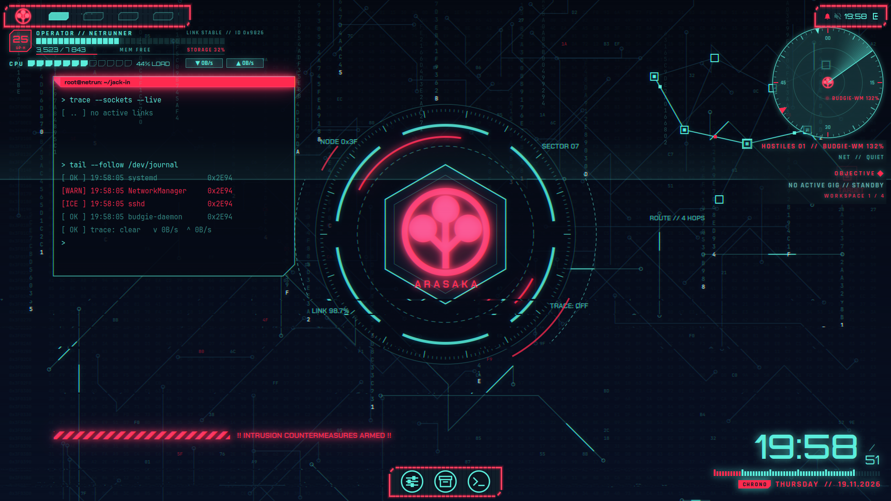

A full desktop suite that turns **Ubuntu Budgie 24.04 (Budgie 10.9 on X11)** into a netrunner workstation inspired by *Cyberpunk 2077*'s UI: midnight blue backgrounds, neon red window frames, cyan text and icons, 45° chamfered corners, a game-style HUD that reacts to your PC, and a themed terminal.

It includes a lightweight animated wallpaper (scanline, rotating arcs, blinking network nodes, data packets, and periodic glitches), GTK widgets with true chamfered corners, and an optional Plymouth boot splash (`// JACKING IN`) between GRUB and the login screen.


The core desktop theme installs strictly at user level with a single script (`./install.sh`) and requires no root privileges. System-level assets — login screen, GRUB, and Plymouth boot splash — are **completely optional**: they have their own separate `sudo` scripts and can be safely omitted if you prefer not to touch system files. Every run automatically backs up your current configuration, and `uninstall.sh` restores everything back to how it was.

---

## Table of Contents

- [What's Included](#whats-included)
- [The Game HUD](#the-game-hud)
- [Screenshots](#screenshots)
- [Requirements](#requirements)
- [Installation](#installation)
- [Configuration (`cyberneon.conf`)](#configuration-cyberneonconf)
- [Changing the Logo](#changing-the-logo)
- [What `install.sh` Does Under the Hood](#what-installsh-does-under-the-hood)
- [Optional System Assets: Login (LightDM), GRUB, and Plymouth](#optional-system-assets-login-lightdm-grub-and-plymouth)
- [Uninstalling](#uninstalling)
- [Trying It in the Lab](#trying-it-in-the-lab)
- [Repository Structure](#repository-structure)
- [Advanced Customization](#advanced-customization)
- [Technical Notes & Workarounds](#technical-notes--workarounds)
- [Regenerating Screenshots](#regenerating-screenshots)
- [Credits, Trademarks, and Licenses](#credits-trademarks-and-licenses)

---

## What's Included

| Component | Description |
|---|---|
| **`CyberNeon` GTK Theme** | Recolored Pocillo-dark base (GTK 2/3/4) with custom CSS overrides: buttons with 45° chamfered corners and cyan outlines (solid cyan for primary actions, red for destructive ones), chamfered input entries and HUD tooltips, striped progress bars. Also generates a matching palette for GTK4/libadwaita apps (`~/.config/gtk-4.0/gtk.css`). |
| **Window Decorations** | Neon red titlebar with a 45° top-left cut, three HUD status squares, red perimeter border, and minimal window buttons. Dark red for unfocused windows. CSD (headerbar) windows get a red ring with a neon glow. |
| **Budgie Panels** | With the game HUD the top bar becomes two floating pods, as in the KDE edition: the logo menu and the workspaces at the top left, tray, `HH:MM` clock and system menus at the top right. The dock floats at the bottom center with your apps only. `DOCK_POSITION="left"` (and the classic layout) brings back the 34 px top bar with the `YYYY-MM-DD HH:MM` clock and the 90 px vertical dock joined to it by a 45° diagonal. Plank is disabled automatically. |
| **`CyberNeon-Icons`** | Custom cyan ringed icons for main dock apps, plus a custom AppMenu badge replacing the default Budgie bird (designed and generated with AI assistance / Python scripts). Inherits the rest from **Papirus-Dark** using a custom "cyber" folder palette (cyan, teal, and red). |
| **`CyberNeon-Cursors`** | Custom Xcursor theme with neon glow: blade pointer, crosshair link cursor, bracketed I-beam, and an animated counter-rotating ring spinner. |
| **Wallpaper & Visual Assets** | Generated via Python and AI-assisted tooling (3840×2160): hex dumps, PCB traces, central radial seal, terminal window with intrusion logs, network node graph, and neon bloom. |
| **Live Wallpaper** | Transparent animated overlay running above the static wallpaper: scanline, rotating arcs around the seal, blinking network nodes, moving data packets, falling hex columns, and periodic strip-shift glitches. Runs at 15 fps in the same process as the HUD (together about 11% of one core on a Xeon E3 v3), passes mouse clicks through, and can be disabled in config (`LIVE_WALLPAPER="no"`). |
| **Game HUD** | Biomonitor, threat radar with objective tracker, Chrono and Quickhack OSD, reacting to load, network, intrusions and battery ([details](#the-game-hud)). `HUD_STYLE="classic"` keeps the previous Conky panel and ShowTime clock. |
| **Terminal & Prompt** | CyberNeon color scheme for Tilix + two-line bash prompt with red/cyan segments and git branch indicator (requires a Nerd Font). Also applies slight transparency (90%) to Nemo file manager windows. |
| **Fonts** | Chakra Petch, Rajdhani, and Orbitron (SIL OFL license, bundled in `assets/fonts`). |
| **Login, GRUB & Plymouth *(Optional)*** | Not required for the desktop theme and can be skipped. Includes a theme for `slick-greeter` (LightDM), custom GRUB boot menu, and a Plymouth boot splash (`// JACKING IN`) with LUKS password HUD. Installed individually via separate `sudo` scripts. |
| **Qt Apps (Kvantum, *Optional*)** | If Kvantum is installed, automatically applies the matching HUD style to Qt applications. |

## The Game HUD

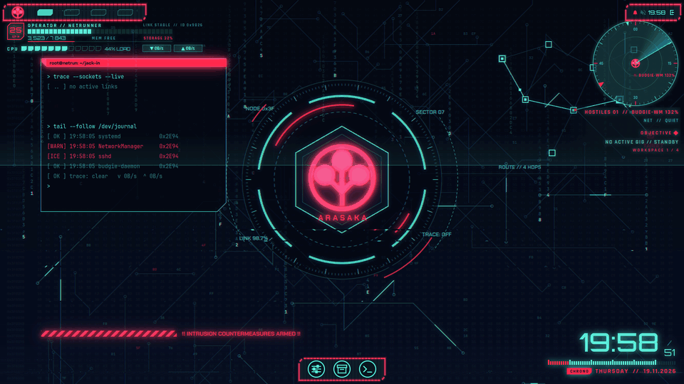

<sub>Captured on the real Budgie 10.9 in the Docker lab, which is why the operator is called NETRUNNER: on your PC it's your user name.</sub>

The Conky panel and the ShowTime clock have made way for a HUD laid out like the one in the game. Everything on it is drawn from scratch and shows real data from your machine. If you prefer the old look, `HUD_STYLE="classic"` brings it back.

| Where | Widget | What it shows |
|---|---|---|
| Top left corner | **Logo and workspaces** | A floating pod with your logo (it opens the app menu) and one tile per workspace, the current one filled. |
| Top left | **Biomonitor** | Uptime as a level badge, free RAM as a segmented bar, free CPU as blocks, disk, network and your name. |
| Top right corner | **System pod** | Tray, notifications, the clock and the system menus in a second pod. |
| Top right | **Threat radar** and objective tracker | Programs that weigh on your PC are contacts: the heavier, the closer to the center, from cyan to yellow to red. Arrows on the rim are programs moving data, red diamonds are intrusions ([details](#the-threat-radar)). The active window is your objective, the other open windows are sub-objectives. |
| Bottom right | **Chrono** | The time as an ammo counter: the seconds left are the reserve and 60 notches empty out over the minute. |
| Bottom center | **Dock** | Your apps as quick slots in a floating bar. A slot stays empty until you hover it, and the active window becomes a cyan plate. |
| Above the dock | **Quickhack OSD** | Volume and brightness as an upload bar, in place of Budgie's OSD. |

Notifications move to the bottom left, because the radar now lives in their old corner.

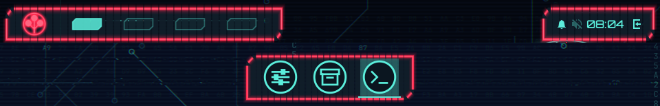

### The threat radar

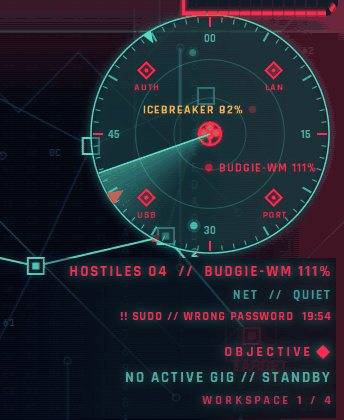

In the game the minimap tells you who's around and how dangerous they are. Here the enemies are whatever slows your PC down, uses your network or tries to get in.

- **Contacts.** Every program with a real load is a dot, and all the processes of one program count as one, so Firefox's twenty processes are a single contact. The closer to the center, the heavier: a whole CPU core or 30% of the RAM puts it in the red. Bigger dots use more memory, the sweep lights them up as it passes, and the yellow and red ones carry their name and load, like `FIREFOX 92%`. When nothing heavy is running the radar is empty and says `ZONE CLEAR`.
- **Traffic.** A program downloading gets an arrow pointing in, one uploading an arrow pointing out, and the faster it goes the longer the arrow. The line under the radar names the top downloader and uploader, so you see at a glance who's eating your bandwidth.
- **Sentinel.** A red diamond with a short tag (`USB`, `AUTH`, `SSH`, `PORT`, `LAN`) blinks on the rim for a minute and the line under the radar says what happened and when:
  - a USB device is plugged in (a stick that also declares a keyboard is reported as a keyboard, because that's the "BadUSB" trick);
  - someone types a wrong password for sudo, su, the lock screen or the login screen;
  - an SSH login, or a failed one;
  - a program opens a port to the network;
  - a device shows up on your network for the first time.
- **The alert names the culprit.** When alert mode kicks in, the Biomonitor also says who's to blame: `!! OVERLOAD // CPU 97% // FIREFOX`.
- **Quickhack.** Click a contact and a panel opens with two quickhacks: **OVERLOAD** closes the program the normal way, so a browser still saves its session, and **FLATLINE** kills every process of it, losing unsaved work. Nothing happens until you press **UPLOAD** to confirm, then an upload bar fills and the program goes down. The desktop session itself (window manager, panel, sound, the HUD) and other users' processes show up as **PROTECTED** and can't be touched. Only the contacts take clicks, the rest of the radar lets them through to the desktop. `QUICKHACK="no"` turns it off.

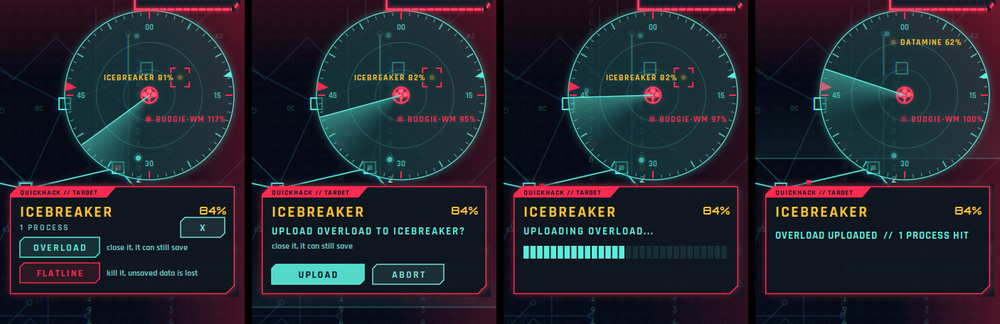

The dial still tells the time: a red notch for the hour, a cyan one for the minute, and the sweep does the seconds. A scan takes about 10 ms of CPU every 3 seconds and needs no root. Only program names appear. The login lines are read from the journal (your user has to be in the `adm` group, as the first Ubuntu user already is) but never shown, and the devices the radar has met are stored as salted hashes. `SENTINEL="no"` turns the intrusion part off.

### It reacts to your PC

| | |
|---|---|
| 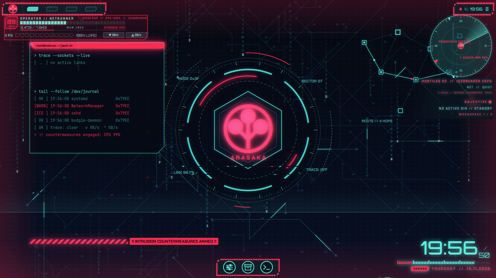 **Alert mode** | 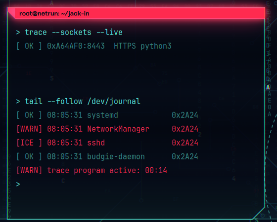 **Live terminal** on the wallpaper |
| 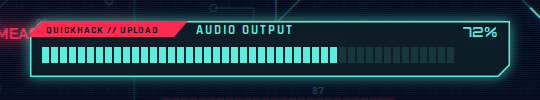 **Quickhack OSD** | 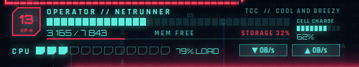 **CELL CHARGE** and TUXEDO profile (both simulated in the lab) |

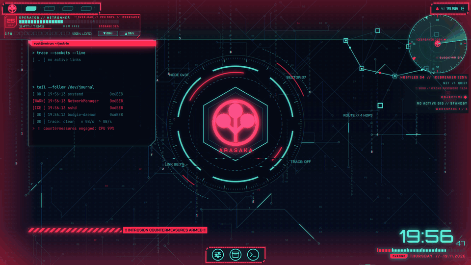

- **Alert mode.** If the CPU or RAM stays over 85% for 3 seconds, or the CPU or GPU reaches 95 °C, the Biomonitor frame pulses red and says why and which program is to blame, `INTRUSION COUNTERMEASURES ARMED` flashes, the screen edges turn red and the wallpaper glitches every second or two. It ends after 6 calm seconds. RAM doesn't count the page cache.
- **Live terminal.** The terminal on the wallpaper lists your network connections and recent journal activity. Above 5 MB/s it prints `[WARN] trace program active`. IP addresses become tags that change at every boot and journal messages are never shown, but program names are visible, so keep that in mind for screenshots (`LIVE_TERMINAL="no"` turns it off).
- **Sounds.** Off by default, on with `SOUND_FX="yes"`: a low chirp for notifications (silent in Do Not Disturb), a warning for alert mode and a jack-in when the session starts. They're synthesized by `scripts/make_sounds.py`, and you can hear them in [`docs/sounds`](docs/sounds).
- **Battery.** On laptops the Biomonitor gains a CELL CHARGE gauge. On battery below 20% the wallpaper and the radar stop moving until you plug in.
- **TUXEDO Control Center.** Only where it's running, the status line shows the active profile. It's read-only.

Not everything from the [KDE edition](https://github.com/AlanNappi/KDE-Cyberneon) can come along. Blurred glass, the glow around normal windows, the GPU glitch on windows and Alt+Tab with live previews need a compositor that `budgie-wm` isn't.

## Screenshots

| | |
|---|---|
|  **GTK widgets with chamfered corners** (actual capture) | 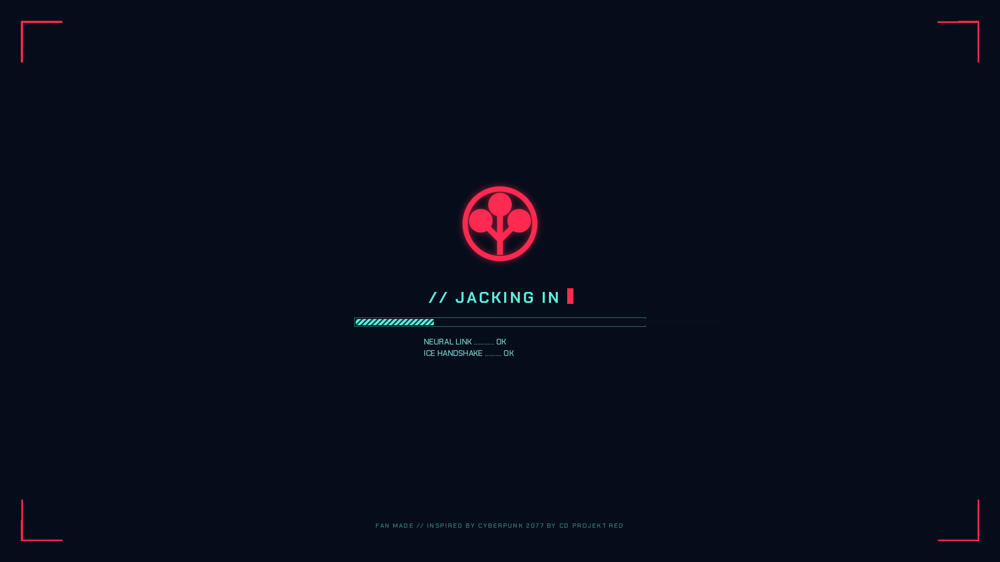 **Plymouth boot splash** (actual capture, see [preview](#plymouth-boot-splash)) |
|  **Wallpaper** (with original CyberNeon crest) |  **Bash prompt + Tilix** |
| 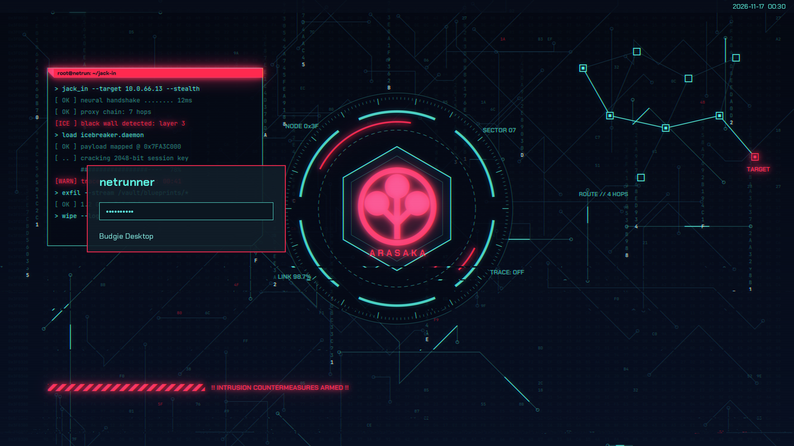 **LightDM Login** |  **GRUB Menu** |

**Icons** — custom dock launchers and recolored Papirus-Dark folders:

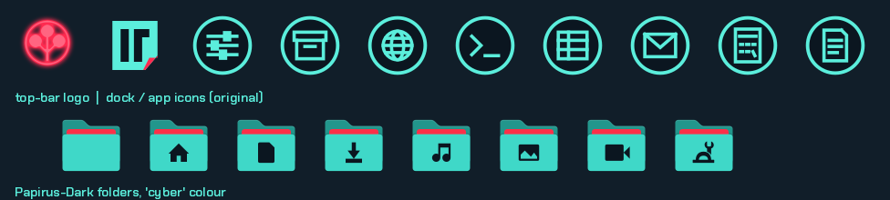

**Cursors** — shown on light and dark backgrounds:


> Screenshots show the default repo setup using the Arasaka logo (© CD PROJEKT S.A.). Setting `LOGO=""` in `cyberneon.conf` switches to the original hexagonal CyberNeon crest.

## Requirements

- **Ubuntu Budgie 24.04** (Budgie Desktop **10.9**) running an **X11** session. Budgie 10.10+ on Wayland is not supported.
- Dependencies (most are already pre-installed on Ubuntu Budgie):

  ```bash
  sudo apt install python3-pil python3-cairo python3-gi gir1.2-gtk-3.0 \
                   gir1.2-wnck-3.0 x11-utils x11-xserver-utils curl ubuntu-budgie-themes conky-all
  ```

  `ubuntu-budgie-themes` provides the Pocillo-dark base and `gir1.2-wnck-3.0` feeds the objective tracker. `conky-all` is only needed for the classic layout, and `grub-common` (`grub-mkfont`) only if you decide to install the optional GRUB theme. The live terminal uses `ss` and the Quickhack OSD uses `busctl`, both normally present.
- An active internet connection on the first run to download Papirus (~33 MB).
- Recommended: **JetBrainsMono Nerd Font** for prompt glyphs.
- With `DOCK_POSITION="left"`, the diagonal panel joint is calibrated for a **16:9** primary monitor (the resolution is detected automatically).

## Installation

```bash
git clone https://github.com/AlanNappi/Budgy-Cyberneon.git cyberneon-budgie
cd cyberneon-budgie
./install.sh
```

Available flags:

| Flag | Effect |
|---|---|
| `--no-restart` | Skips restarting the window manager and panel at the end (window frame changes will apply on next login) |
| `--skip-papirus` | Skips downloading Papirus (keeps your current folder icons) |
| `-h` | Shows help |

The installer is **idempotent**: you can re-run it as many times as you like (for instance, after tweaking `cyberneon.conf`) without duplicating panels or appending duplicate blocks to `~/.bashrc`.

Once finished:
- **Cursor and theme**: active immediately (already running apps will pick up the new cursor on restart).
- **Bash prompt**: active in all newly opened terminal tabs/windows.
- **HUD and live wallpaper**: start right away and are added to autostart (`~/.config/autostart/cyberneon-hud.desktop`).
- **Login, GRUB, and Plymouth**: **not installed by default**. They are non-essential and can be omitted; if you want them, run their [optional system scripts](#optional-system-assets-login-lightdm-grub-and-plymouth).

## Configuration (`cyberneon.conf`)

`install.sh` reads settings from `cyberneon.conf` (standard bash syntax). Relative paths are resolved from the repo root.

| Variable | Default | Description |
|---|---|---|
| `LOGO` | `assets/logo/arasaka-logo.webp` | Image placed at the center of the wallpaper and used as the top-left AppMenu icon (tinted neon red). Leave empty (`""`) to use the original CyberNeon crest. |
| `LABEL` | `A R A S A K A` | Text rendered below the central seal on the wallpaper. |
| `HUD_LABEL` | *(empty)* | Operator name shown by the HUD. If empty, defaults to your system username in uppercase. |
| `WALLPAPER` | `cyberneon-arasaka-red.png` | Output filename generated in `~/Pictures/Wallpapers`. |
| `NEMO_OPACITY` | `0.90` | Window opacity for Nemo file manager (`1.0` = fully opaque). |
| `LIVE_WALLPAPER` | `yes` | Enables the `CyberNeon Live` animated overlay (`no` = static wallpaper only). |
| `LIVE_FPS` | `15` | Frame rate for the animated wallpaper (lower it to use even less CPU). |
| `HUD_STYLE` | `game` | `game` for the new HUD, `classic` for the Conky panel and ShowTime clock. |
| `DOCK_POSITION` | `bottom` | `bottom` for the two top pods and the floating dock, `left` for the top bar and the vertical dock. The classic layout always uses `left`. |
| `REACTIVE_HUD` | `yes` | Alert mode based on real load. |
| `ALERT_CPU`, `ALERT_RAM`, `ALERT_TEMP` | `85`, `85`, `95` | Alert limits: CPU %, RAM % (page cache excluded), °C of the hotter of CPU and GPU. |
| `LIVE_TERMINAL` | `yes` | Real, scrambled data in the wallpaper terminal. |
| `TRACE_MBPS` | `5` | MB/s of traffic that prints `trace program active`. |
| `SENTINEL` | `yes` | The radar also flags intrusions: USB devices, wrong passwords, SSH logins, new open ports, new devices on your network. |
| `QUICKHACK` | `yes` | A click on a radar contact can close that program, after a confirmation. |
| `CYBER_OSD` | `yes` | Quickhack OSD in place of Budgie's. |
| `SOUND_FX` | `no` | Sound theme and jack-in at session start. |
| `LOW_POWER_PERCENT` | `20` | Battery level below which animations stop (`0` = never). |
| `PINNED` | settings, Nemo, Firefox, Tilix, Calc | `.desktop` launchers pinned to the dock (missing apps are skipped automatically). |
| `UI_FONT` / `DOC_FONT` | `Chakra Petch Medium 10` / `Chakra Petch 10` | Interface fonts. |
| `TITLE_FONT` | `Chakra Petch Bold 10` | Window title font (also dictates titlebar height in Mutter; see [technical notes](#technical-notes--workarounds)). |

## Changing the Logo

By default, the repo uses `assets/logo/arasaka-logo.webp` (property of **CD PROJEKT S.A.**, included as a non-commercial fan tribute under [CDPR's Fan Content Guidelines](https://www.cdprojektred.com/en/fan-content)). The script tints it neon red with bloom and places it inside the central wallpaper seal (desktop, login, GRUB, Plymouth) as well as replacing the `ubuntu-budgie-symbolic` icon in the top-left corner.

To use your own custom logo instead:
1. Drop a transparent PNG or WebP image into `assets/logo/`.
2. Update `LOGO=` and `LABEL=` in `cyberneon.conf`.
3. Re-run `./install.sh`.

If you set `LOGO=""`, the generator draws the original CyberNeon crest (a hexagon with a V-visor).

## What `install.sh` Does Under the Hood

1. **Environment checks**: verifies an active X11/Budgie session, required Python modules, and Pocillo-dark availability. Detects primary monitor dimensions and offset via `xrandr`.
2. **Backup**: saves a full snapshot in `~/.local/share/cyberneon/backups/<timestamp>/` containing a `dconf` dump, `~/.bashrc`, `~/.config/gtk-4.0/gtk.css`, Plank autostart, `~/.xsessionrc`, and Kvantum config. On the very first run, it also locks a copy into `backups/pristine/`, which `uninstall.sh` uses to roll back to a clean state.
3. **Fonts & Papirus**: installs fonts to `~/.local/share/fonts/cyberneon/` and fetches Papirus (pinned release `20260801`, or latest if `PAPIRUS_TAG=latest` is set) into `~/.local/share/icons/Papirus{,-Dark}`, applying the custom "cyber" folder color.
4. **GTK theme build**: runs `scripts/build_theme.py` to recolor Pocillo-dark, inject custom CSS overrides (`theme/*-overrides.css`), generate 9-slice SVG border assets for chamfered corners (`make_gtk_assets.py`), and write the libadwaita palette.
5. **Icons & Cursors**: builds `CyberNeon-Icons` (`make_icons.py` + `make_logo_icon.py`) and writes raw Xcursor binaries directly into `CyberNeon-Cursors` (`make_cursors.py`), creating the required symlinks in `~/.icons/`. Also creates a local `.desktop` override for the Firefox Snap so it obeys the custom icon theme.
6. **Wallpapers & staged system assets**: renders the 4K wallpaper (`make_wallpaper.py`) and pre-generates LightDM, GRUB, and Plymouth assets inside `~/.local/share/cyberneon/system/` (ready to be used only if you later choose to run the system installers).
7. **Desktop configuration**: applies GTK/WM themes, icons, cursors, and fonts via `gsettings`, rebuilds the Budgie panels (`panels.py`), disables Plank, moves notifications to the bottom left and loads the Tilix color scheme. With the classic layout it positions the ShowTime clock instead.
8. **User services**: adds the prompt hook to `~/.bashrc`, installs the HUD in `~/.config/cyberneon/hud`, sets up the Nemo opacity daemon, autostart, the optional sound theme and the Kvantum theme (if installed).
9. **Hot reload**: restarts `budgie-wm` (automatically fixing the `_NET_SUPPORTING_WM_CHECK` X11 root property), `budgie-panel` and the HUD.

## Optional System Assets: Login (LightDM), GRUB, and Plymouth

> **Note:** Installing these components is **not required** for the desktop theme to work. If you prefer to keep all changes strictly within your user home directory or don't want to touch your bootloader/initramfs, you can skip all of them (or pick only the ones you want).

If you decide to install them, run `./install.sh` at least once as your regular user (to generate the staged assets), then run any of the following:

```bash
sudo bash system/install-login.sh      # Optional: slick-greeter theme (LightDM)
sudo bash system/install-grub.sh       # Optional: GRUB bootloader theme
sudo bash system/install-plymouth.sh   # Optional: Plymouth boot splash ("jack-in")
```

### `install-login.sh` (LightDM)
- Copies wallpaper, GTK theme, cursors, and fonts into `/usr/share/...`.
- Writes `/etc/lightdm/slick-greeter.conf` (backing up any existing file to `.bak-cyberneon`).
- **To revert**: `sudo rm /etc/lightdm/slick-greeter.conf` (or restore the `.bak-cyberneon` file).

### `install-grub.sh` (GRUB)
- Installs the theme to `/boot/grub/themes/cyberneon/` and backs up `/etc/default/grub` to `/etc/default/grub.bak-cyberneon`.
- Sets `GRUB_THEME`, `GRUB_TIMEOUT_STYLE=menu`, `GRUB_TIMEOUT=5`, and `GRUB_GFXMODE=1920x1080,auto`, then runs `update-grub`. *(Note: Ubuntu hides GRUB by default with a 0s timeout; this script makes the menu visible for 5 seconds on boot).*
- **To revert**: `sudo cp /etc/default/grub.bak-cyberneon /etc/default/grub && sudo update-grub`.

### Plymouth Boot Splash
- Copies the theme into `/usr/share/plymouth/themes/cyberneon/`, registers it as `default.plymouth` via `update-alternatives`, and rebuilds the initramfs (`update-initramfs -u`). Requires `splash` in `GRUB_CMDLINE_LINUX_DEFAULT` (present by default on Ubuntu).
- **To revert**: `sudo bash system/install-plymouth.sh --undo`.
- **Preview in Docker without installing or rebooting**: run `bash lab/plymouth-preview.sh` to spin up Ubuntu 24.04's actual Plymouth inside a disposable headless container and dump screenshots of the boot sequence and LUKS password prompt into `lab/out/` without touching your host system.

## Uninstalling

```bash
./uninstall.sh          # Restores the pristine backup (dconf, panels, themes) and removes CyberNeon files
./uninstall.sh --purge  # Same as above, plus removes bundled fonts and Papirus icons
```

Restores the `dconf` dump from `backups/pristine/`, cleans up theme files, configs, autostarts, and the `~/.bashrc` prompt block, stops the live wallpaper, re-enables Plank, and restarts the window manager and panels. If you installed any of the optional system-level tweaks (LightDM, GRUB, Plymouth), revert them with the commands listed in the section above.

## Trying It in the Lab

`lab/` runs the real Budgie 10.9 of Ubuntu 24.04 in Docker, on a virtual screen, and leaves your desktop alone:

```bash
bash lab/run-lab.sh     # about 1.5 GB to download the first time, results in lab/out/
```

It runs the real `install.sh`, then checks the HUD with a real CPU load and real traffic from a second container, plugs a fake USB keyboard into the radar, types a wrong sudo password into a fake journal, clicks the radar to quickhack a test program (and to check the window manager is protected), and finally tries the classic layout and `uninstall.sh`. `results.txt` lists every check.

Battery and TUXEDO Control Center are simulated there, volume changes are sent as the same D-Bus call the keys produce, and the audio player only logs what it would play.

## Repository Structure

```
cyberneon-budgie/
├── install.sh / uninstall.sh  user-level installer and rollback script
├── cyberneon.conf             configuration file
├── theme/
│   ├── gtk-3.0-overrides.css  GTK3 CSS overrides (frames, panels, widgets, Raven, notifications)
│   ├── gtk-4.0-overrides.css  rules for non-libadwaita GTK4 apps
│   ├── libadwaita.css         color palette for libadwaita apps (~/.config/gtk-4.0/gtk.css)
│   ├── dock-bottom.css        floating dock at the bottom
│   ├── top-pods.css           the two pods that replace the top bar
│   └── quickhack-osd.css      hides Budgie's OSD when the Quickhack one is active
├── scripts/
│   ├── build_theme.py         recolors Pocillo-dark and merges CSS overrides
│   ├── make_gtk_assets.py     generates 9-slice SVG frames for chamfered GTK widgets
│   ├── make_icons.py          ringed dock icons and menu badge generator
│   ├── make_logo_icon.py      converts custom logo into the Budgie AppMenu icon
│   ├── make_cursors.py        direct Xcursor binary builder
│   ├── make_wallpaper.py      4K wallpaper generator
│   ├── make_system_assets.py  LightDM and GRUB asset generator
│   ├── make_plymouth.py       Plymouth script and sprite builder
│   ├── make_sounds.py         synthetic sound theme (standard library only)
│   ├── make_kvantum.py        Kvantum theme builder for Qt apps
│   ├── panels.py              idempotent Budgie panel layout script
│   ├── restart_wm.sh          clean budgie-wm restart with EWMH property fix
│   ├── install_fonts.sh       local font installer
│   ├── install_papirus.sh     Papirus fetcher and "cyber" folder setup
│   └── make_docs.py           documentation image generator
├── config/
│   ├── hud/                   game HUD and animated wallpaper (GTK/Cairo on X11), helper scripts in bin/
│   ├── conky/                 classic HUD (cyberneon.conf, hud.lua)
│   ├── bash/prompt.bash       bash prompt configuration
│   ├── tilix/cyberneon.json   Tilix color scheme
│   └── nemo-opacity.sh        X11 daemon for Nemo window transparency
├── system/                    optional system installers (LightDM, GRUB, Plymouth)
├── assets/                    fonts (SIL OFL) and Arasaka logo (© CD PROJEKT S.A.)
├── lab/                       Docker test lab (run-lab.sh) and Plymouth preview (plymouth-preview.sh)
└── docs/                      screenshots, GIFs and sounds
```

## Advanced Customization

**Color Palette**

| Role | Hex |
|---|---|
| Neon red (active frames, bars, accents) | `#ff2a4f` |
| Dark red (inactive window frames) | `#8c1a33` |
| Primary cyan (strong text, borders, accents) | `#5beedc` |
| Secondary cyan (body text) | `#7eddd5` |
| Panel & CSD headerbar blue | `#111e29` |
| Window background blue | `#0f1b26` |
| Input entry & view blue | `#0b1620` |
| Deep desktop blue | `#070d1a` |

CSS variables (`@red`, `@cy`, `@navy`, etc.) are declared at the top of `theme/gtk-3.0-overrides.css`, while base theme color replacements live in the `HEX` dict inside `scripts/build_theme.py`. Re-run `./install.sh` after making changes.

**Panel & Wallpaper Corner Joint Geometry**
With `DOCK_POSITION="left"`, the 45° diagonal joint in the top-left corner aligns three separate pieces (if you resize the panels, update all three):
- **Left dock (90 px)**: icons span 0–76 px, red border bar spans 76–90 px (`.left .budgie-panel` in `gtk-3.0-overrides.css`).
- **Top bar (34 px)**: red block from 76 to 110 px (`.top .budgie-panel` via `linear-gradient`) and a 116 px leading spacer (`--spacer` in `panels.py`).
- **Wallpaper triangle**: drawn directly onto the background image at coordinates `(90,34)-(110,34)-(90,54)` (section 8 of `make_wallpaper.py`).

## Technical Notes & Workarounds

A few under-the-hood details on how GTK3, Mutter, and X11 quirks are handled:

- **`budgie-wm` CSS cache & EWMH race condition**: `budgie-wm` caches the theme on startup, requiring a restart when window decoration CSS changes. However, running `budgie-wm --replace` often triggers a race condition between the old and new instances that wipes `_NET_SUPPORTING_WM_CHECK` from the X11 root window (causing GTK apps to stop drawing CSD borders and shadows). `scripts/restart_wm.sh` detects this and restores the X11 atom automatically.
- **Server-Side Decorations (SSD) in Mutter**: on traditional windows, the visible border is actually the `padding` of `.ssd decoration`. The 45° top-left cut is drawn using a `linear-gradient(135deg, transparent 15px, …)` on the red decoration background while keeping the titlebar above it transparent.
- **No blurred glow on SSD windows**: unlike CSD windows, Mutter's server-side decorations lack an alpha channel for outer shadows; applying a blurred `box-shadow` turns into a solid red block or leaves black artifacts on focus changes. Outer neon glow is therefore restricted to CSD windows.
- **Titlebar height & button centering**: Mutter sizes the titlebar strictly after the title font height (`TITLE_FONT`, 19 px with Chakra Petch Bold 10), top-aligns window buttons, and ignores `margin`, `padding`, and `min-height` on them. To center them vertically, bottom frame padding is zeroed out and the square icons are rendered as centered SVG backgrounds.
- **Chamfered corners in GTK3 without `clip-path`**: GTK3's CSS engine doesn't support `clip-path`. To get true cut corners on buttons, entries, and tooltips, the theme uses `border-image` with a 9-slice 24×24 SVG (6 px bevel). Since GTK3 doesn't fill the center slice of a `border-image`, the interior uses standard `background-color` restricted to `background-clip: padding-box`, keeping the outer cut corners genuinely transparent.
- **`libXcursor` search paths on Ubuntu 24.04**: `libXcursor 1.2.1` looks for cursor themes in `~/.icons` and `/usr/share/icons`, ignoring `~/.local/share/icons`. The installer creates the required symlinks in `~/.icons`.
- **Nemo transparency**: Nemo windows don't expose a native alpha channel on their background; `nemo-opacity.sh` applies transparency at the compositor level via `_NET_WM_WINDOW_OPACITY`.
- **Live Wallpaper window**: `config/hud/cn_wallpaper.py` spawns an X11 window of type `DESKTOP` with an RGBA visual and an empty input shape (so mouse clicks pass straight through to Nemo's desktop icons below). For the glitch effect, it reads the actual wallpaper path from `org.gnome.desktop.background` and shifts horizontal slices.
- **Replacing Budgie's OSD**: Budgie has no setting to turn its OSD off. The HUD follows the `ShowOSD` calls on the session bus with `busctl --user monitor`, and `theme/quickhack-osd.css` makes the original window fully transparent. It still opens for a moment, invisible, at the bottom center of the screen.
- **A floating dock in a panel**: Budgie's dock mode centers the panel but keeps it against the screen edge. The frame is drawn with 8 px of empty space below it, and only the sides use a `border-image`, so the panel stays as tall as the strip it reserves and maximized windows stop above the dock.
- **Pods in a top panel**: Budgie can style the three groups of a panel separately (`theme-regions`). With the panel itself transparent, the left and right groups become the two pods. `panels.py` remembers which applets it moved (the menu and the workspaces from the dock, plus a task list or app menu the top bar already had) in `~/.local/share/cyberneon/panels-state.json`, and `DOCK_POSITION="left"` puts them back. The frames are tiled rather than stretched, because GTK fades the ends of a small stretched image.
- **Neon glow without a GPU effect**: each widget is drawn once per update, its alpha channel is blurred with Pillow and used as a mask for the glow. Only the radar sweep, its contacts and the pulsing frames are redrawn between updates.
- **A threat radar without root**: per-program traffic comes from the kernel's TCP byte counters (`ss -i`), read only when the network moves more than 16 KB/s, because matching sockets to processes means walking the open files of every process. QUIC (HTTP/3) runs over UDP and has no counters, so the leftover traffic goes to the program holding UDP sockets on port 443. Memory is resident minus shared, otherwise twenty Firefox processes would count the same libraries twenty times. The scan runs in a worker thread so the animation never stutters, and the same file (`config/hud/cn_threats.py`) is `cn-threats` in the KDE edition.
- **`gsettings list-schemas | grep -q` with `pipefail`**: `grep -q` exits at the first match, `gsettings` dies on the closed pipe and the whole test looks false. The installer reads the full list instead.
- **Variable scope in Plymouth**: in Plymouth's `script` module, variables declared inside a function are garbage-collected as soon as the function returns, making sprites vanish instantly. To keep the LUKS password HUD on screen, all prompt sprites are stored on the `global.*` object.
- **Avoiding self-kill with `pgrep -f` / `pkill -f`**: scripts use the `pgrep -f '[n]ame'` trick so `pkill` doesn't match the subshell's own command line and kill the installer.

## Regenerating Screenshots

```bash
python3 scripts/make_docs.py   # Rebuilds docs/wallpaper.jpg, icons.png, cursors.png, prompt.png, grub.png, login.png
```

`docs/live-wallpaper.gif` and `docs/widgets.png` are real captures from an X11 session, `docs/plymouth.png` is captured via `lab/plymouth-preview.sh`, and `docs/desktop.png`, `hud.gif`, `radar.gif`, `quickhack.png`, `dock.png`, `alert.*`, `live-terminal.png`, `quickhack-osd.png` and `battery.png` come from `bash lab/run-lab.sh`.

## Credits, Trademarks, and Licenses

**CD PROJEKT RED / *Cyberpunk 2077***
- CyberNeon is an **unofficial, non-commercial fan project**, built as a tribute to the UI design and atmosphere of *Cyberpunk 2077*.
- *Cyberpunk 2077*, *Arasaka*, *Night City*, and all related trademarks, names, and logos are the exclusive property and registered trademarks of **CD PROJEKT S.A.** This repository is not affiliated with, sponsored, or endorsed by CD PROJEKT RED.
- Visual assets (wallpapers, custom dock icons, cursors, badges and HUD widgets) and the optional sounds were created using a combination of procedural Python/Cairo scripts and **AI generation tools**; no graphical assets, fonts or audio were ripped or extracted from the game. The only third-party brand asset included is the **Arasaka logo** (`assets/logo/arasaka-logo.webp`), used strictly as a fan tribute in compliance with [CD PROJEKT RED's Fan Content Guidelines](https://www.cdprojektred.com/en/fan-content) and excluded from the repository's open-source license.
- If CD PROJEKT RED requests any changes or removal of copyrighted material, it will be done immediately.

**Third-Party Components**
- **Pocillo** (`ubuntu-budgie-themes` package, GPL-2.0): used as the base GTK theme and recolored. The generated theme is a GPL-2.0 derivative work.
- **Papirus icon theme** (GPL-3.0): downloaded from GitHub during installation, not bundled in this repo.
- **Chakra Petch** (Cadson Demak), **Rajdhani** (Indian Type Foundry), **Orbitron** (Matt McInerney): bundled in `assets/fonts` under the SIL Open Font License 1.1.
- **Budgie Desktop**, **Conky**, **ShowTime** (`budgie-extras`), **Tilix**, **Nemo**: used by the configuration, unmodified.

**Repository License**: GPL-2.0 (see `LICENSE`), except for the third-party components and trademarks listed above.

---
---

<a name="italiano"></a>

# CyberNeon — tema netrunner per Ubuntu Budgie

> **Nota (Fan Project):** CyberNeon è un progetto amatoriale, non ufficiale e non commerciale, nato dalla passione per *Cyberpunk 2077*. L'estetica a cui si ispira, il nome *Cyberpunk 2077* e il logo *Arasaka* incluso nel repository (`assets/logo/`) sono marchi e proprietà esclusiva di **CD PROJEKT S.A.** Questo progetto non è affiliato né approvato da CD PROJEKT RED (vedi [Crediti e licenze](#crediti-marchi-e-licenze) e [`NOTICE.md`](NOTICE.md)).


Un tema completo che trasforma **Ubuntu Budgie 24.04 (Budgie 10.9 su X11)** in una postazione da netrunner ispirata alle interfacce di *Cyberpunk 2077*: fondo blu notte, cornici rosso neon, testi e icone ciano, angoli tagliati a 45°, un HUD da videogioco che reagisce al tuo PC e terminale a tema.

Include uno sfondo animato leggero (scansione, nodi di rete, pacchetti dati e glitch), widget GTK con veri angoli smussati e, opzionalmente, una splash di boot Plymouth (`// JACKING IN`) tra GRUB e il login.


Tutto il tema desktop si installa a livello utente con un singolo script (`./install.sh`), senza bisogno di permessi di root. Gli asset di sistema — schermata di login, GRUB e splash di avvio Plymouth — **non sono fondamentali per il funzionamento del tema**: hanno script separati con `sudo` e possono essere tranquillamente omessi se non vuoi modificare file di sistema. Ogni installazione fa un backup automatico della configurazione attuale e `uninstall.sh` ripristina tutto com'era prima.

---

## Indice

- [Cosa include](#cosa-include)
- [L'HUD da videogioco](#lhud-da-videogioco)
- [Screenshot](#screenshot)
- [Requisiti](#requisiti)
- [Installazione](#installazione)
- [Configurazione (`cyberneon.conf`)](#configurazione-cyberneonconf)
- [Cambiare il logo](#cambiare-il-logo)
- [Cosa fa `install.sh` sotto il cofano](#cosa-fa-installsh-sotto-il-cofano)
- [Asset di sistema opzionali: Login (LightDM), GRUB e Plymouth](#asset-di-sistema-opzionali-login-lightdm-grub-e-plymouth)
- [Disinstallazione](#disinstallazione)
- [Provarlo nel laboratorio](#provarlo-nel-laboratorio)
- [Struttura del repository](#struttura-del-repository)
- [Personalizzazione avanzata](#personalizzazione-avanzata)
- [Note tecniche e workaround](#note-tecniche-e-workaround)
- [Rigenerare gli screenshot](#rigenerare-gli-screenshot)
- [Crediti, marchi e licenze](#crediti-marchi-e-licenze)

---

## Cosa include

| Componente | Descrizione |
|---|---|
| **Tema GTK `CyberNeon`** | Basato su Pocillo-dark (GTK 2/3/4) ricolorato con pesanti override CSS: pulsanti con angoli tagliati a 45° e bordo ciano (pieni ciano per le azioni primarie, rossi per quelle distruttive), input box e tooltip smussati, progress bar a strisce diagonali. Include la palette per le app GTK4/libadwaita (`~/.config/gtk-4.0/gtk.css`). |
| **Decorazioni finestre** | Titlebar rosso neon con taglio a 45° in alto a sinistra, tre quadratini HUD, bordo rosso perimetrale e pulsanti finestra minimali. Rosso scuro per le finestre inattive. Le finestre CSD (headerbar) hanno un bordo rosso con bagliore neon. |
| **Pannelli Budgie** | Con l'HUD da videogioco la barra superiore diventa due riquadri fluttuanti, come nell'edizione KDE: in alto a sinistra il menu col logo e i workspace, in alto a destra area di notifica, orologio `HH:MM` e menu di sistema. La dock fluttua in basso al centro con le sole app. `DOCK_POSITION="left"` (e il layout classico) riporta la barra da 34 px con l'orologio `AAAA-MM-GG HH:MM` e la dock verticale da 90 px unita alla barra da un raccordo a 45°. Plank viene disattivato. |
| **Icone `CyberNeon-Icons`** | Icone circolari ciano per le app principali nella dock, più logo custom per l'AppMenu al posto del simbolo di Budgie (realizzate tramite generazione IA e script Python). Eredita il resto da **Papirus-Dark** applicando una variante cartelle "cyber" (ciano, petrolio e rosso). |
| **Cursori `CyberNeon-Cursors`** | Tema cursori Xcursor con alone neon: puntatore a lama, mirino sui link, I-beam tra parentesi e spinner animato con anelli controrotanti. |
| **Sfondo e immagini** | Generati tramite script Python e strumenti IA (3840×2160): dump esadecimale, piste PCB, sigillo centrale, finestra terminale con log di intrusione, grafo dei nodi e bloom. |
| **Live Wallpaper** | Livello trasparente animato che gira sopra lo sfondo statico: linea di scansione, archi rotanti attorno al sigillo, nodi che lampeggiano, pacchetti in transito, pioggia hex e glitch periodici. Gira a 15 fps nello stesso processo dell'HUD (insieme circa l'11% di un core su uno Xeon E3 v3), ignora i clic del mouse ed è disattivabile da config (`LIVE_WALLPAPER="no"`). |
| **HUD da videogioco** | Biomonitor, radar delle minacce con tracker degli obiettivi, Chrono e OSD Quickhack, che reagiscono a carico, rete, intrusioni e batteria ([dettagli](#lhud-da-videogioco)). `HUD_STYLE="classic"` mantiene il vecchio pannello Conky e l'orologio ShowTime. |
| **Terminale e Prompt** | Schema colori per Tilix + prompt bash su due righe con segmenti rosso/ciano e branch git (richiede un Nerd Font). Leggera trasparenza (90%) applicata anche al file manager Nemo. |
| **Font** | Chakra Petch, Rajdhani e Orbitron (licenza SIL OFL, già inclusi in `assets/fonts`). |
| **Login, GRUB e Plymouth *(Opzionali)*** | Non fondamentali per il tema desktop, possono essere omessi. Includono il tema per `slick-greeter` (LightDM), menu GRUB custom e splash di boot Plymouth (`// JACKING IN`) con prompt HUD per dischi cifrati (LUKS). Si installano singolarmente con script `sudo` separati. |
| **App Qt (Kvantum, *Opzionale*)** | Se Kvantum è installato, applica automaticamente lo stesso tema HUD alle applicazioni Qt. |

## L'HUD da videogioco


<sub>Catturato sul vero Budgie 10.9 nel laboratorio Docker, ed è per questo che l'operatore si chiama NETRUNNER: sul tuo PC c'è il tuo nome utente.</sub>

Il pannello Conky e l'orologio ShowTime hanno lasciato il posto a un HUD organizzato come quello del gioco. Ogni elemento è disegnato da zero e mostra dati veri del tuo PC. Se preferisci il vecchio aspetto, con `HUD_STYLE="classic"` torna com'era.

| Dove | Widget | Cosa mostra |
|---|---|---|
| Nell'angolo in alto a sinistra | **Logo e workspace** | Un riquadro fluttuante con il tuo logo (apre il menu delle app) e una tessera per ogni workspace, piena quella attuale. |
| In alto a sinistra | **Biomonitor** | Le ore di accensione come badge del livello, la RAM libera su una barra a segmenti, la CPU libera a blocchi, poi disco, rete e il tuo nome. |
| Nell'angolo in alto a destra | **Riquadro di sistema** | Area di notifica, notifiche, orologio e menu di sistema in un secondo riquadro. |
| In alto a destra | **Radar delle minacce** e tracker degli obiettivi | I programmi che pesano sul PC sono contatti: più pesano, più stanno vicino al centro, dal ciano al giallo al rosso. Le frecce sul bordo sono programmi che muovono dati, i rombi rossi sono intrusioni ([dettagli](#il-radar-delle-minacce)). La finestra attiva è il tuo obiettivo, le altre aperte sono i sotto-obiettivi. |
| In basso a destra | **Chrono** | L'ora come un contatore di munizioni: i secondi rimasti sono la riserva e 60 tacche si svuotano durante il minuto. |
| In basso al centro | **Dock** | Le tue app come slot rapidi in una barra fluttuante. Uno slot resta vuoto finché non ci passi sopra, e la finestra attiva diventa una piastra ciano. |
| Sopra la dock | **OSD Quickhack** | Volume e luminosità come una barra di upload, al posto dell'OSD di Budgie. |

Le notifiche si spostano in basso a sinistra, perché nel loro vecchio angolo adesso c'è il radar.


### Il radar delle minacce


Nel gioco la minimappa ti dice chi hai intorno e quanto è pericoloso. Qui i nemici sono quello che rallenta il PC, usa la tua rete o prova a entrare.

- **Contatti.** Ogni programma con un carico vero è un puntino, e tutti i processi di un programma contano come uno solo: i venti processi di Firefox sono un contatto. Più è vicino al centro, più pesa: un core della CPU intero o il 30% della RAM lo fanno diventare rosso. I puntini più grandi usano più memoria, il fascio li accende quando ci passa sopra, e quelli gialli e rossi hanno accanto nome e carico, tipo `FIREFOX 92%`. Se non gira niente di pesante il radar è vuoto e scrive `ZONE CLEAR`.
- **Traffico.** Un programma che scarica ha una freccia verso il centro, uno che carica una freccia verso fuori, e più va veloce più la freccia è lunga. La riga sotto il radar dice chi scarica e chi carica di più, così vedi subito chi ti mangia la banda.
- **Sentinella.** Un rombo rosso con una sigla (`USB`, `AUTH`, `SSH`, `PORT`, `LAN`) lampeggia sul bordo per un minuto e la riga sotto il radar dice cosa è successo e a che ora:
  - si collega un dispositivo USB (una chiavetta che si presenta anche come tastiera viene segnalata come tastiera, perché è il trucco delle "BadUSB");
  - qualcuno sbaglia la password di sudo, di su, del blocco schermo o del login;
  - un accesso SSH, riuscito o fallito;
  - un programma apre una porta verso la rete;
  - un dispositivo compare per la prima volta nella tua rete.
- **L'allerta dice chi è il colpevole.** Quando scatta la modalità allerta, il Biomonitor dice anche di chi è la colpa: `!! OVERLOAD // CPU 97% // FIREFOX`.
- **Quickhack.** Clicchi su un contatto e si apre un pannello con due quickhack: **OVERLOAD** chiude il programma nel modo normale, così un browser fa in tempo a salvare la sessione, e **FLATLINE** chiude con la forza tutti i suoi processi, perdendo il lavoro non salvato. Non succede niente finché non premi **UPLOAD** per confermare, poi una barra di upload si riempie e il programma va giù. La sessione del desktop (gestore delle finestre, pannello, audio, l'HUD) e i processi di altri utenti risultano **PROTECTED** e non si toccano. Prendono i clic solo i contatti, il resto del radar li lascia passare al desktop. `QUICKHACK="no"` lo spegne.


Il quadrante segna ancora l'ora: una tacca rossa per le ore, una ciano per i minuti, e il fascio fa i secondi. Una scansione costa circa 10 ms di CPU ogni 3 secondi e non serve root. Si vedono solo i nomi dei programmi. Le righe di login le legge dal journal (il tuo utente deve essere nel gruppo `adm`, come lo è già il primo utente di Ubuntu) ma non le mostra mai, e i dispositivi che il radar ha già visto sono salvati come hash con sale. `SENTINEL="no"` spegne la parte delle intrusioni.

### Reagisce al tuo PC

| | |
|---|---|
|  **Modalità allerta** |  **Terminale live** sullo sfondo |
|  **OSD Quickhack** |  **CELL CHARGE** e profilo TUXEDO (entrambi simulati nel laboratorio) |


- **Modalità allerta.** Se CPU o RAM restano sopra l'85% per 3 secondi, oppure CPU o GPU arrivano a 95 °C, il bordo del Biomonitor pulsa di rosso e dice il motivo e quale programma è il colpevole, `INTRUSION COUNTERMEASURES ARMED` lampeggia, i bordi dello schermo diventano rossi e lo sfondo fa un glitch ogni secondo o due. Finisce dopo 6 secondi di calma. Dalla RAM è esclusa la cache.
- **Terminale live.** Il terminale sullo sfondo elenca le connessioni di rete e le ultime attività del journal. Sopra i 5 MB/s scrive `[WARN] trace program active`. Gli indirizzi IP diventano etichette che cambiano a ogni avvio e i messaggi del journal non vengono mostrati, ma i nomi dei programmi si vedono: tienine conto negli screenshot (`LIVE_TERMINAL="no"` lo spegne).
- **Suoni.** Spenti di default, si attivano con `SOUND_FX="yes"`: un chirp basso per le notifiche (muto con "Non disturbare"), un avviso per l'allerta e un jack-in all'avvio della sessione. Li sintetizza `scripts/make_sounds.py` e puoi ascoltarli in [`docs/sounds`](docs/sounds).
- **Batteria.** Sui portatili il Biomonitor mostra anche CELL CHARGE. A batteria sotto il 20% sfondo e radar si fermano finché non ricarichi.
- **TUXEDO Control Center.** Solo dove è in esecuzione, la riga di stato mostra il profilo attivo, in sola lettura.

Non tutto quello dell'[edizione KDE](https://github.com/AlanNappi/KDE-Cyberneon) si può portare qui. Vetro sfocato, alone attorno alle finestre normali, glitch GPU sulle finestre e Alt+Tab con anteprime dal vivo richiedono un compositor che `budgie-wm` non è.

## Screenshot

| | |
|---|---|
|  **Widget GTK con angoli tagliati** (screenshot reale) |  **Splash Plymouth** (cattura reale, vedi [anteprima](#install-plymouthsh-plymouth)) |
|  **Sfondo** (con stemma originale CyberNeon) |  **Prompt bash + Tilix** |
|  **Login LightDM** |  **Menu GRUB** |

**Icone** — lanciatori dock (originali) e cartelle Papirus-Dark ricolorate:


**Cursori** — resa su fondo chiaro e scuro:


> Gli screenshot mostrano la configurazione di default con il logo Arasaka (© CD PROJEKT S.A.). Impostando `LOGO=""` in `cyberneon.conf` viene generato e usato lo stemma esagonale originale di CyberNeon.

## Requisiti

- **Ubuntu Budgie 24.04** (Budgie Desktop **10.9**) su sessione **X11**. Budgie 10.10+ su Wayland non è supportato.
- Dipendenze (quasi tutte già preinstallate su Ubuntu Budgie):

  ```bash
  sudo apt install python3-pil python3-cairo python3-gi gir1.2-gtk-3.0 \
                   gir1.2-wnck-3.0 x11-utils x11-xserver-utils curl ubuntu-budgie-themes conky-all
  ```

  `ubuntu-budgie-themes` serve come base per Pocillo-dark e `gir1.2-wnck-3.0` alimenta il tracker degli obiettivi. `conky-all` serve solo per il layout classico e `grub-common` (`grub-mkfont`) solo se decidi di installare anche il tema opzionale per GRUB. Il terminale live usa `ss` e l'OSD Quickhack usa `busctl`, di solito già presenti.
- Connessione a Internet al primo avvio dell'installer per scaricare Papirus (~33 MB).
- Consigliato **JetBrainsMono Nerd Font** per i glifi del prompt bash.
- Con `DOCK_POSITION="left"`, il raccordo geometrico tra i pannelli è calibrato per un monitor principale **16:9** (la risoluzione viene rilevata in automatico).

## Installazione

```bash
git clone https://github.com/AlanNappi/Budgy-Cyberneon.git cyberneon-budgie
cd cyberneon-budgie
./install.sh
```

Opzioni disponibili:

| Opzione | Effetto |
|---|---|
| `--no-restart` | Non riavvia window manager e pannello a fine script (le nuove cornici si vedranno al login successivo) |
| `--skip-papirus` | Salta il download di Papirus (mantiene le icone cartella attuali) |
| `-h` | Mostra l'aiuto |

Lo script è **idempotente**: puoi rilanciarlo quante volte vuoi (ad esempio dopo aver ritoccato `cyberneon.conf`) senza ritrovarti pannelli duplicati o blocchi ripetuti nel `.bashrc`.

Una volta terminato:
- **Cursore e tema**: attivi da subito (le app già aperte aggiorneranno il cursore al prossimo riavvio).
- **Prompt bash**: attivo in tutti i nuovi terminali.
- **HUD e sfondo animato**: partono immediatamente e vengono messi in autostart (`~/.config/autostart/cyberneon-hud.desktop`).
- **Login, GRUB e Plymouth**: **non vengono installati di default**. Non sono fondamentali e possono essere omessi; se vuoi aggiungerli, puoi usare i relativi [script di sistema opzionali](#asset-di-sistema-opzionali-login-lightdm-grub-e-plymouth).

## Configurazione (`cyberneon.conf`)

`install.sh` legge le opzioni da `cyberneon.conf` (normale sintassi bash). I percorsi relativi partono dalla root del repository.

| Variabile | Default | Descrizione |
|---|---|---|
| `LOGO` | `assets/logo/arasaka-logo.webp` | Immagine al centro dello sfondo e nell'icona AppMenu in alto a sinistra (viene tinta di rosso neon). Se lasciato vuoto (`""`), usa lo stemma originale CyberNeon. |
| `LABEL` | `A R A S A K A` | Testo sotto il sigillo centrale nello sfondo. |
| `HUD_LABEL` | *(vuoto)* | Nome dell'operatore mostrato dall'HUD. Se vuoto, usa lo username di sistema in maiuscolo. |
| `WALLPAPER` | `cyberneon-arasaka-red.png` | Nome del file generato in `~/Pictures/Wallpapers`. |
| `NEMO_OPACITY` | `0.90` | Opacità delle finestre di Nemo (`1.0` = completamente opaco). |
| `LIVE_WALLPAPER` | `yes` | Attiva lo sfondo animato `CyberNeon Live` (`no` = solo sfondo statico). |
| `LIVE_FPS` | `15` | Framerate dello sfondo animato (abbassalo se vuoi consumare ancora meno CPU). |
| `HUD_STYLE` | `game` | `game` per il nuovo HUD, `classic` per il pannello Conky e l'orologio ShowTime. |
| `DOCK_POSITION` | `bottom` | `bottom` per i due riquadri in alto e la dock fluttuante, `left` per la barra in alto e la dock verticale. Il layout classico usa sempre `left`. |
| `REACTIVE_HUD` | `yes` | Modalità allerta in base al carico reale. |
| `ALERT_CPU`, `ALERT_RAM`, `ALERT_TEMP` | `85`, `85`, `95` | Soglie dell'allerta: % CPU, % RAM (cache esclusa), °C del più caldo tra CPU e GPU. |
| `LIVE_TERMINAL` | `yes` | Dati reali e camuffati nel terminale dello sfondo. |
| `TRACE_MBPS` | `5` | MB/s di traffico oltre i quali compare `trace program active`. |
| `SENTINEL` | `yes` | Il radar segnala anche le intrusioni: dispositivi USB, password sbagliate, accessi SSH, nuove porte aperte, nuovi dispositivi in rete. |
| `QUICKHACK` | `yes` | Un clic su un contatto del radar può chiudere quel programma, dopo una conferma. |
| `CYBER_OSD` | `yes` | OSD Quickhack al posto di quello di Budgie. |
| `SOUND_FX` | `no` | Tema sonoro e jack-in all'avvio della sessione. |
| `LOW_POWER_PERCENT` | `20` | Livello di batteria sotto il quale le animazioni si fermano (`0` = mai). |
| `PINNED` | impostazioni, Nemo, Firefox, Tilix, Calc | File `.desktop` fissati nella dock (quelli non installati vengono ignorati). |
| `UI_FONT` / `DOC_FONT` | `Chakra Petch Medium 10` / `Chakra Petch 10` | Font dell'interfaccia. |
| `TITLE_FONT` | `Chakra Petch Bold 10` | Font delle titlebar (determina anche l'altezza della barra del titolo in Mutter, vedi [note tecniche](#note-tecniche-e-workaround)). |

## Cambiare il logo

Di default il repository usa `assets/logo/arasaka-logo.webp` (proprietà di **CD PROJEKT S.A.**, incluso come tributo fan-made non commerciale secondo le [linee guida sui contenuti dei fan di CDPR](https://www.cdprojektred.com/en/fan-content)). Lo script lo ricolora in rosso neon con bloom e lo inserisce sia al centro dello sfondo (desktop, login, GRUB, Plymouth) sia al posto dell'icona `ubuntu-budgie-symbolic` in alto a sinistra.

Se vuoi sostituirlo con un tuo logo personale:
1. Metti il tuo file PNG o WebP (con sfondo trasparente) in `assets/logo/`.
2. Aggiorna `LOGO=` e `LABEL=` dentro `cyberneon.conf`.
3. Rilancia `./install.sh`.

Se invece imposti `LOGO=""`, lo script disegna lo stemma originale di CyberNeon (un esagono con visiera a V).

## Cosa fa `install.sh` sotto il cofano

1. **Verifica dell'ambiente**: controlla che la sessione sia X11/Budgie, verifica i moduli Python e rileva geometria e risoluzione del monitor primario tramite `xrandr`.
2. **Backup**: salva in `~/.local/share/cyberneon/backups/<data-ora>/` il dump completo di `dconf`, `~/.bashrc`, `~/.config/gtk-4.0/gtk.css`, l'autostart di Plank, `~/.xsessionrc` e la config di Kvantum. Alla primissima esecuzione congela una copia in `backups/pristine/`, usata da `uninstall.sh` per riportare il sistema allo stato vergine.
3. **Font e Papirus**: copia i font in `~/.local/share/fonts/cyberneon/` e scarica Papirus (release `20260801`, o l'ultima se passi `PAPIRUS_TAG=latest`) in `~/.local/share/icons/Papirus{,-Dark}` applicando le cartelle color ciano/petrolio.
4. **Build del tema GTK**: esegue `scripts/build_theme.py` che ricolora Pocillo-dark, inietta i CSS custom (`theme/*-overrides.css`), genera gli asset SVG a 9-slice per gli angoli tagliati (`make_gtk_assets.py`) e scrive la palette per libadwaita.
5. **Icone e Cursori**: genera `CyberNeon-Icons` (`make_icons.py` + `make_logo_icon.py`) e scrive direttamente i binari Xcursor in `CyberNeon-Cursors` (`make_cursors.py`), creando i symlink necessari in `~/.icons/`. Crea anche un override locale del `.desktop` di Firefox Snap per fargli usare l'icona del tema.
6. **Sfondi e preparazione asset di sistema**: genera il wallpaper 4K (`make_wallpaper.py`) e prepara in `~/.local/share/cyberneon/system/` gli asset per LightDM, GRUB e Plymouth (che restano lì pronti all'uso solo se deciderai di installarli).
7. **Configurazione desktop**: applica temi e font via `gsettings`, ricostruisce i pannelli di Budgie (`panels.py`), disattiva Plank, sposta le notifiche in basso a sinistra e carica la palette di Tilix. Con il layout classico posiziona invece l'orologio ShowTime.
8. **Servizi utente**: attiva il prompt in `~/.bashrc`, installa l'HUD in `~/.config/cyberneon/hud`, configura lo script di trasparenza per Nemo, l'autostart, il tema sonoro facoltativo e (se presente) il tema Kvantum per Qt.
9. **Reload a caldo**: riavvia `budgie-wm` (correggendo al volo la proprietà X11 `_NET_SUPPORTING_WM_CHECK`), `budgie-panel` e l'HUD.

## Asset di sistema opzionali: Login (LightDM), GRUB e Plymouth

> **Nota:** L'installazione di questi tre componenti **non è fondamentale** per usare CyberNeon. Se preferisci mantenere tutte le modifiche confinate nella tua home utente senza toccare bootloader, initramfs o display manager, puoi tranquillamente ometterli tutti (oppure installare solo quello che ti interessa).

Se decidi di installarli, assicurati di aver lanciato `./install.sh` almeno una volta da utente normale (serve a generare i file nella home), poi esegui uno o più dei seguenti script:

```bash
sudo bash system/install-login.sh      # Opzionale: tema per slick-greeter (LightDM)
sudo bash system/install-grub.sh       # Opzionale: tema per il bootloader GRUB
sudo bash system/install-plymouth.sh   # Opzionale: splash screen di boot (Plymouth)
```

### `install-login.sh` (LightDM)
- Copia sfondo, tema GTK, cursori e font nelle directory di sistema (`/usr/share/...`).
- Scrive `/etc/lightdm/slick-greeter.conf` (salvando un backup `.bak-cyberneon` se esiste già).
- **Per rimuoverlo**: `sudo rm /etc/lightdm/slick-greeter.conf` (o ripristina il file `.bak-cyberneon`).

### `install-grub.sh` (GRUB)
- Installa il tema in `/boot/grub/themes/cyberneon/` e fa un backup di `/etc/default/grub` in `/etc/default/grub.bak-cyberneon`.
- Imposta `GRUB_THEME`, `GRUB_TIMEOUT_STYLE=menu`, `GRUB_TIMEOUT=5` e `GRUB_GFXMODE=1920x1080,auto`, poi lancia `update-grub`. *(Nota: di default Ubuntu nasconde GRUB con timeout a 0; lo script lo mostra per 5 secondi all'avvio).*
- **Per rimuoverlo**: `sudo cp /etc/default/grub.bak-cyberneon /etc/default/grub && sudo update-grub`.

### `install-plymouth.sh` (Plymouth)
- Copia il tema in `/usr/share/plymouth/themes/cyberneon/`, lo imposta come predefinito tramite `update-alternatives` e rigenera l'initramfs (`update-initramfs -u`). Richiede che `splash` sia presente in `GRUB_CMDLINE_LINUX_DEFAULT` (su Ubuntu c'è già di default).
- **Per rimuoverlo**: `sudo bash system/install-plymouth.sh --undo`.
- **Test in container senza installare né riavviare**: puoi lanciare `bash lab/plymouth-preview.sh` per far girare il vero Plymouth di Ubuntu 24.04 dentro un container Docker headless e salvare gli screenshot della sequenza di boot e del prompt LUKS in `lab/out/` senza toccare il tuo PC.

## Disinstallazione

```bash
./uninstall.sh          # Ripristina il backup iniziale (dconf, pannelli, temi) e rimuove i file CyberNeon
./uninstall.sh --purge  # Come sopra, ma rimuove anche i font e il pacchetto icone Papirus
```

Lo script ricarica il dump `dconf` salvato in `backups/pristine/`, pulisce i file di configurazione, ferma il live wallpaper, riattiva Plank e riavvia window manager e pannelli. Se hai installato anche qualcuno dei componenti di sistema opzionali con `sudo` (LightDM, GRUB, Plymouth), puoi rimuoverli con i comandi indicati nella sezione precedente.

## Provarlo nel laboratorio

`lab/` fa girare il vero Budgie 10.9 di Ubuntu 24.04 in Docker, su uno schermo virtuale, senza toccare il tuo desktop:

```bash
bash lab/run-lab.sh     # la prima volta scarica circa 1,5 GB, i risultati sono in lab/out/
```

Esegue il vero `install.sh`, controlla l'HUD con un carico reale sulla CPU e traffico reale da un secondo container, collega una finta tastiera USB al radar, sbaglia la password di sudo in un finto journal, clicca sul radar per fare un quickhack a un programma di prova (e controllare che il gestore delle finestre sia protetto), poi prova il layout classico e `uninstall.sh`. In `results.txt` trovi tutti i controlli.

Batteria e TUXEDO Control Center lì sono simulati, le variazioni di volume sono inviate con la stessa chiamata D-Bus dei tasti e il lettore audio si limita a registrare cosa suonerebbe.

## Struttura del repository

```
cyberneon-budgie/
├── install.sh / uninstall.sh  script di installazione e ripristino (livello utente)
├── cyberneon.conf             file di configurazione
├── theme/
│   ├── gtk-3.0-overrides.css  override CSS GTK3 (cornici, pannelli, widget, Raven, notifiche)
│   ├── gtk-4.0-overrides.css  regole per app GTK4 standard
│   ├── libadwaita.css         palette per app GTK4/libadwaita (~/.config/gtk-4.0/gtk.css)
│   ├── dock-bottom.css        dock fluttuante in basso
│   ├── top-pods.css           i due riquadri che sostituiscono la barra in alto
│   └── quickhack-osd.css      nasconde l'OSD di Budgie quando è attivo quello Quickhack
├── scripts/
│   ├── build_theme.py         patch cromatica su Pocillo-dark e merge degli override
│   ├── make_gtk_assets.py     generatore di cornici SVG 9-slice per i widget GTK
│   ├── make_icons.py          icone circolari della dock e stemma menu
│   ├── make_logo_icon.py      conversione logo custom per l'AppMenu di Budgie
│   ├── make_cursors.py        generatore diretto dei file binari Xcursor
│   ├── make_wallpaper.py      generatore dello sfondo 4K
│   ├── make_system_assets.py  asset per LightDM e GRUB
│   ├── make_plymouth.py       generatore dello script e degli sprite Plymouth
│   ├── make_sounds.py         tema sonoro sintetico (solo libreria standard)
│   ├── make_kvantum.py        generatore tema Kvantum per app Qt
│   ├── panels.py              setup idempotente dei pannelli Budgie via dconf
│   ├── restart_wm.sh          restart pulito di budgie-wm con fix EWMH
│   ├── install_fonts.sh       installazione font locali
│   ├── install_papirus.sh     download Papirus e setup cartelle "cyber"
│   └── make_docs.py           generazione immagini per il README
├── config/
│   ├── hud/                   HUD da videogioco e sfondo animato (GTK/Cairo su X11), script di supporto in bin/
│   ├── conky/                 HUD classico (cyberneon.conf, hud.lua)
│   ├── bash/prompt.bash       prompt del terminale
│   ├── tilix/cyberneon.json   palette colori per Tilix
│   └── nemo-opacity.sh        demone X11 per la trasparenza di Nemo
├── system/                    installer di sistema opzionali (LightDM, GRUB, Plymouth)
├── assets/                    font (SIL OFL) e logo Arasaka (© CD PROJEKT S.A.)
├── lab/                       laboratorio Docker (run-lab.sh) e anteprima di Plymouth (plymouth-preview.sh)
└── docs/                      screenshot, GIF e suoni
```

## Personalizzazione avanzata

**Palette colori**

| Ruolo | Hex |
|---|---|
| Rosso neon (cornici attive, barre, accenti) | `#ff2a4f` |
| Rosso scuro (cornici finestre inattive) | `#8c1a33` |
| Ciano primario (testi forti, bordi, accenti) | `#5beedc` |
| Ciano secondario (testo standard) | `#7eddd5` |
| Blu pannelli e headerbar CSD | `#111e29` |
| Blu sfondo finestre | `#0f1b26` |
| Blu campi di input e viste | `#0b1620` |
| Blu profondo (sfondo desktop) | `#070d1a` |

Le variabili CSS (`@red`, `@cy`, `@navy`, ecc.) sono definite in cima a `theme/gtk-3.0-overrides.css`, mentre la mappa di sostituzione per il tema base si trova nel dizionario `HEX` dentro `scripts/build_theme.py`. Dopo qualsiasi modifica, rilancia `./install.sh`.

**Allineamento geometrico tra pannelli e sfondo**
Con `DOCK_POSITION="left"`, il raccordo diagonale a 45° nell'angolo in alto a sinistra è ottenuto incastrando tre elementi (se modifichi le dimensioni dei pannelli, vanno aggiornati tutti e tre):
- **Dock sinistra (90 px)**: icone da 0 a 76 px, fascia rossa da 76 a 90 px (`.left .budgie-panel` in `gtk-3.0-overrides.css`).
- **Barra superiore (34 px)**: blocco rosso da 76 a 110 px (`.top .budgie-panel`, gestito con `linear-gradient`) e spaziatore iniziale da 116 px (`--spacer` in `panels.py`).
- **Triangolo di raccordo**: disegnato direttamente sullo sfondo alle coordinate `(90,34)-(110,34)-(90,54)` (sezione 8 di `make_wallpaper.py`).

## Note tecniche e workaround

Qualche dettaglio su come sono stati aggirati i limiti di GTK3, Mutter e X11 durante lo sviluppo:

- **Cache CSS di `budgie-wm` e race condition su EWMH**: `budgie-wm` mette in cache il tema all'avvio, quindi dopo una modifica al CSS serve riavviarlo. Tuttavia, lanciare un semplice `budgie-wm --replace` spesso causa una race condition tra la vecchia e la nuova istanza che cancella la proprietà `_NET_SUPPORTING_WM_CHECK` dalla root window di X11 (col risultato che le app GTK perdono bordi e ombre CSD). Lo script `scripts/restart_wm.sh` intercetta il problema e ripristina l'atomo X11 al volo.
- **Decorazioni Server-Side (SSD) in Mutter**: sulle finestre tradizionali il bordo visibile è il `padding` di `.ssd decoration`. L'angolo tagliato a 45° in alto a sinistra è ottenuto con un `linear-gradient(135deg, transparent 15px, …)` sullo sfondo rosso della decorazione, tenendo la titlebar trasparente sopra di esso.
- **Niente alone sfocato sulle finestre SSD**: a differenza delle finestre CSD, in Mutter le decorazioni server-side non hanno canale alpha per le ombre esterne; aggiungere un `box-shadow` sfocato produce artefatti neri o blocchi rossi pieni al cambio di focus. Per questo il glow neon esterno è attivo solo sulle finestre CSD.
- **Altezza della titlebar e centratura dei pulsanti**: Mutter calcola l'altezza della barra del titolo in base all'altezza del font (`TITLE_FONT`, 19 px con Chakra Petch Bold 10), allinea i pulsanti finestra in alto e ignora `margin`, `padding` e `min-height` sui bottoni. Per centrarli verticalmente, il padding inferiore della cornice è azzerato e i quadratini sono disegnati come background SVG centrati.
- **Angoli tagliati in GTK3 senza `clip-path`**: il motore CSS di GTK3 non supporta `clip-path`. Per tagliare davvero gli angoli di pulsanti, entry e tooltip, il tema usa `border-image` con uno sprite SVG 24×24 a 9-slice (taglio da 6 px). Poiché GTK3 non renderizza la slice centrale del `border-image`, il riempimento interno viene fatto col normale `background-color` confinato tramite `background-clip: padding-box`, lasciando gli spigoli esterni trasparenti.
- **Percorsi di `libXcursor` su Ubuntu 24.04**: `libXcursor 1.2.1` cerca i temi di cursori in `~/.icons` e `/usr/share/icons`, ignorando `~/.local/share/icons`. L'installer crea quindi i symlink necessari in `~/.icons`.
- **Trasparenza di Nemo**: Nemo non espone un canale alpha nativo sul background della finestra; lo script `nemo-opacity.sh` applica la trasparenza tramite la proprietà del compositor `_NET_WM_WINDOW_OPACITY` (che agisce sull'intera finestra).
- **Finestra del Live Wallpaper**: `config/hud/cn_wallpaper.py` crea una finestra X11 di tipo `DESKTOP` con visual RGBA e input shape vuota (così i clic passano direttamente alle icone del desktop sotto). Per generare l'effetto glitch legge l'immagine reale impostata in `org.gnome.desktop.background` e ne trasla delle strisce orizzontali.
- **Sostituire l'OSD di Budgie**: Budgie non ha un'opzione per spegnere il suo OSD. L'HUD segue le chiamate `ShowOSD` sul bus di sessione con `busctl --user monitor`, e `theme/quickhack-osd.css` rende del tutto trasparente la finestra originale. Questa si apre comunque per un momento, invisibile, in basso al centro dello schermo.
- **Una dock fluttuante dentro un pannello**: la modalità dock di Budgie centra il pannello ma lo lascia attaccato al bordo dello schermo. La cornice è disegnata con 8 px vuoti sotto, e solo i lati usano un `border-image`, così il pannello resta alto quanto la striscia che riserva e le finestre massimizzate si fermano sopra la dock.
- **Riquadri dentro un pannello in alto**: Budgie può dare uno stile separato ai tre gruppi di un pannello (`theme-regions`). Con il pannello trasparente, il gruppo di sinistra e quello di destra diventano i due riquadri. `panels.py` si ricorda quali applet ha spostato (menu e workspace dalla dock, più un elenco finestre o un menu delle app che la barra aveva già) in `~/.local/share/cyberneon/panels-state.json`, e con `DOCK_POSITION="left"` li rimette al loro posto. Le cornici sono ripetute invece che stirate, perché GTK sfuma i bordi di un'immagine piccola stirata.
- **Alone neon senza effetti GPU**: ogni widget viene disegnato una volta per aggiornamento, il suo canale alfa viene sfocato con Pillow e usato come maschera per l'alone. Tra un aggiornamento e l'altro si ridisegnano solo il fascio del radar, i suoi contatti e le cornici che pulsano.
- **Un radar delle minacce senza root**: il traffico per programma arriva dai contatori di byte TCP del kernel (`ss -i`), letti solo quando la rete muove più di 16 KB/s, perché abbinare i socket ai processi vuol dire scorrere i file aperti di ogni processo. QUIC (HTTP/3) viaggia su UDP e non ha contatori, quindi il traffico che avanza va al programma che ha socket UDP sulla porta 443. La memoria è quella residente meno la parte condivisa, altrimenti venti processi di Firefox conterebbero venti volte le stesse librerie. La scansione gira in un thread a parte, così l'animazione non scatta mai, e lo stesso file (`config/hud/cn_threats.py`) è `cn-threats` nell'edizione KDE.
- **`gsettings list-schemas | grep -q` con `pipefail`**: `grep -q` esce alla prima corrispondenza, `gsettings` muore sulla pipe chiusa e tutto il test risulta falso. L'installer ora legge l'elenco completo.
- **Scope delle variabili in Plymouth**: nel modulo `script` di Plymouth le variabili dichiarate dentro una funzione vengono distrutte appena la funzione ritorna, facendo sparire gli sprite dallo schermo. Per mantenere visibile l'HUD di sblocco LUKS, tutti gli sprite del prompt devono essere salvati nell'oggetto `global.*`.
- **Autokill con `pgrep -f` / `pkill -f`**: negli script bash è usato il pattern `pgrep -f '[n]ome'` per evitare che `pkill` faccia match con la stringa della subshell stessa uccidendo l'installer.

## Rigenerare gli screenshot

```bash
python3 scripts/make_docs.py   # Rigenera docs/wallpaper.jpg, icons.png, cursors.png, prompt.png, grub.png, login.png
```

`docs/live-wallpaper.gif` e `docs/widgets.png` sono catture reali della sessione X11, `docs/plymouth.png` viene generato tramite `lab/plymouth-preview.sh`, mentre `docs/desktop.png`, `hud.gif`, `radar.gif`, `quickhack.png`, `dock.png`, `alert.*`, `live-terminal.png`, `quickhack-osd.png` e `battery.png` arrivano da `bash lab/run-lab.sh`.

## Crediti, marchi e licenze

**CD PROJEKT RED / *Cyberpunk 2077***
- CyberNeon è un progetto **fan-made, non ufficiale e senza scopo di lucro**, realizzato come tributo all'estetica di *Cyberpunk 2077*.
- *Cyberpunk 2077*, *Arasaka*, *Night City* e tutti i marchi, nomi e loghi correlati sono proprietà esclusiva e marchi registrati di **CD PROJEKT S.A.** Questo repository non è affiliato, sponsorizzato né approvato da CD PROJEKT RED.
- Gli asset grafici del tema (sfondi, icone della dock, cursori, stemmi e widget dell'HUD) e i suoni facoltativi sono stati realizzati combinando script Python/Cairo e **strumenti di generazione IA**; nessun asset grafico, font o audio è stato estratto dal gioco. L'unico elemento di terze parti incluso è il **logo Arasaka** (`assets/logo/arasaka-logo.webp`), utilizzato a scopo puramente dimostrativo in conformità con le [Fan Content Guidelines di CD PROJEKT RED](https://www.cdprojektred.com/en/fan-content) ed escluso dalla licenza open-source del repository.
- Qualora CD PROJEKT RED richiedesse modifiche o la rimozione di qualsiasi riferimento, verrà fatto immediatamente.

**Componenti di terze parti**
- **Pocillo** (pacchetto `ubuntu-budgie-themes`, GPL-2.0): usato come base del tema GTK e ricolorato. Il tema generato è un'opera derivata rilasciata sotto GPL-2.0.
- **Papirus icon theme** (GPL-3.0): scaricato da GitHub durante l'installazione, non incluso nel repository.
- **Chakra Petch** (Cadson Demak), **Rajdhani** (Indian Type Foundry), **Orbitron** (Matt McInerney): inclusi in `assets/fonts` sotto licenza SIL Open Font License 1.1.
- **Budgie Desktop**, **Conky**, **ShowTime** (`budgie-extras`), **Tilix**, **Nemo**: utilizzati dalla configurazione senza modifiche.

**Licenza del repository**: GPL-2.0 (vedi `LICENSE`), ad eccezione dei componenti di terze parti e dei marchi registrati indicati sopra.
