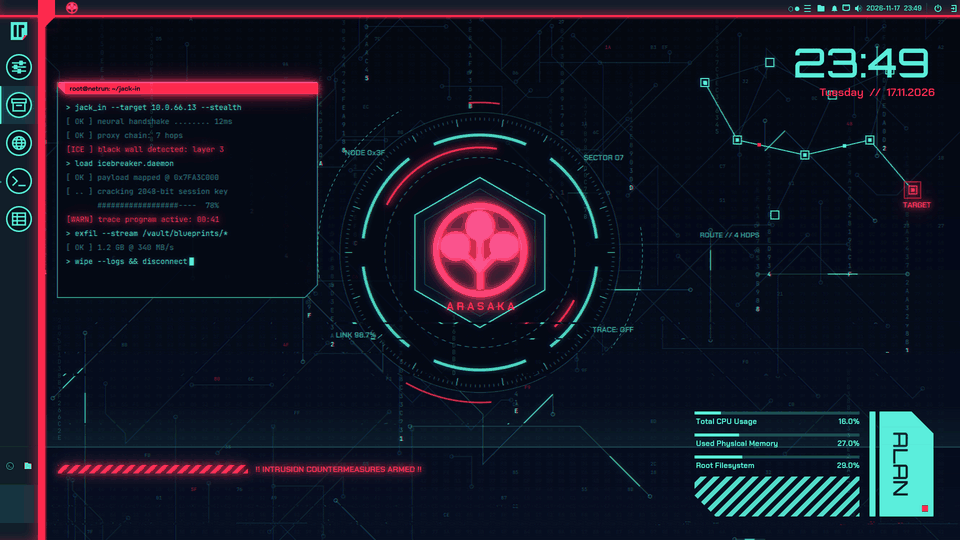
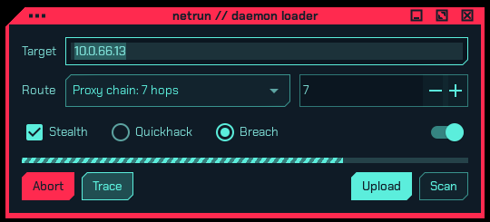
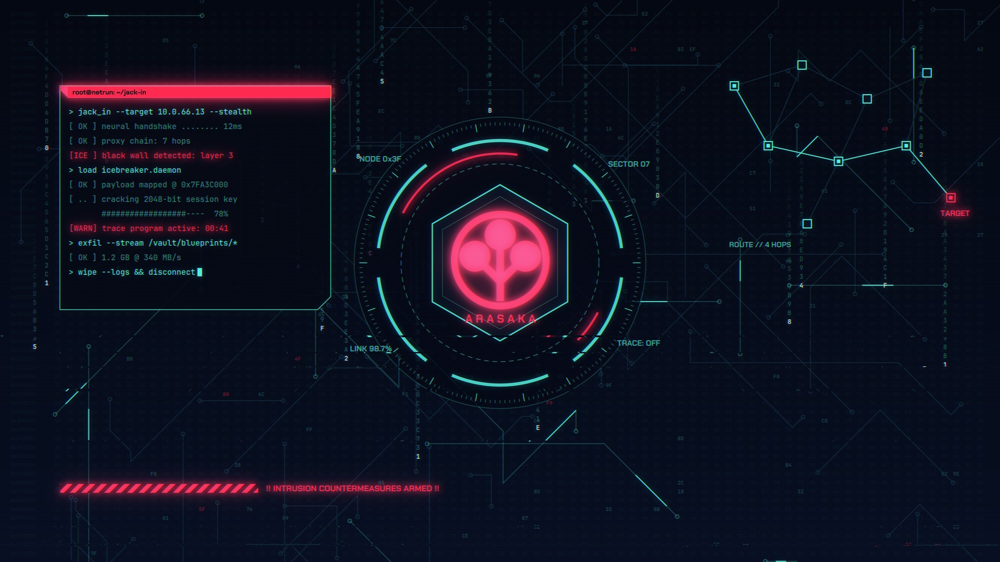
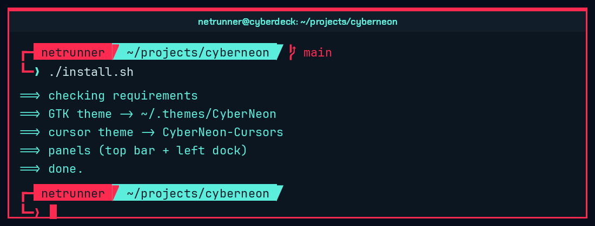
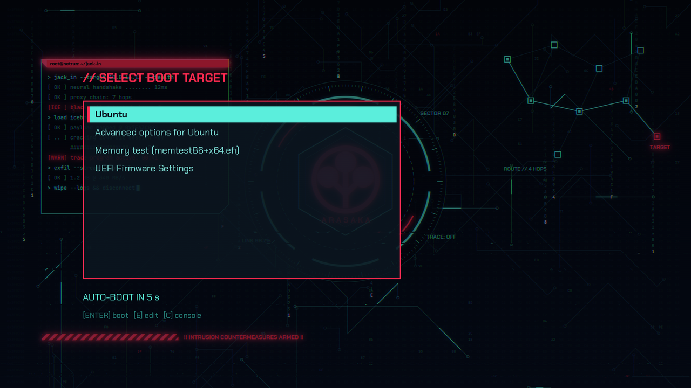
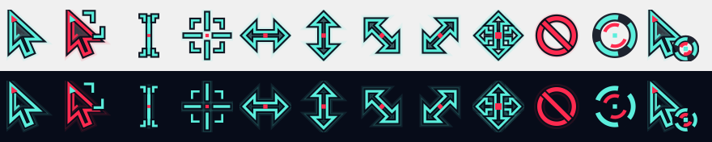

# CyberNeon — tema "netrunner" per Ubuntu Budgie

> ## ⚠ Fan made — tutto il merito a CD PROJEKT RED
> **CyberNeon è un progetto FAN MADE, realizzato da un grandissimo fan di _Cyberpunk 2077_ e di CD PROJEKT RED.**
> È **ispirato a _Cyberpunk 2077_ di CD PROJEKT RED**: l'universo, lo stile e l'atmosfera a cui si ispira sono **opera di CD PROJEKT RED**.
> _Cyberpunk 2077_, Arasaka e tutti i nomi, i loghi e i marchi collegati **appartengono a CD PROJEKT S.A.**
> Progetto **non ufficiale** e **non commerciale**: non è affiliato, sponsorizzato né approvato da CD PROJEKT RED.
> L'unico elemento di CD PROJEKT RED incluso è il **logo Arasaka** (`assets/logo/`), usato come omaggio fan made: resta di CD PROJEKT S.A. (vedi [Crediti e marchi](#crediti-marchi-e-licenze) e [`NOTICE.md`](NOTICE.md)).


CyberNeon è un **fan tribute** che trasforma un desktop **Ubuntu Budgie 24.04 (Budgie 10.9, X11)** in un'interfaccia da
netrunner **ispirata all'estetica di *Cyberpunk 2077* di CD PROJEKT RED** (tutto il merito dello stile va a loro): blu notte, cornici rosso neon,
testi e icone ciano, angoli tagliati a 45°, HUD di sistema e sfondo "hacking".

Lo sfondo è **animato** (linea di scansione, archi che ruotano, rete che lampeggia, pacchetti di dati, glitch), i widget
GTK hanno **angoli tagliati veri** e c'è una **splash di avvio "jack-in"** tra GRUB e il login.



Tutto si installa a livello utente con un solo comando; login, GRUB e splash di avvio hanno script separati con `sudo`.
Ogni installazione salva un backup e `uninstall.sh` riporta il sistema allo stato precedente.

---

## Indice

- [Cosa include](#cosa-include)
- [Screenshot](#screenshot)
- [Requisiti](#requisiti)
- [Installazione rapida](#installazione-rapida)
- [Configurazione (`cyberneon.conf`)](#configurazione-cyberneonconf)
- [Logo](#logo)
- [Cosa fa `install.sh`, passo per passo](#cosa-fa-installsh-passo-per-passo)
- [Schermata di login e GRUB](#schermata-di-login-e-grub)
- [Disinstallazione](#disinstallazione)
- [Struttura del repository](#struttura-del-repository)
- [Personalizzazione avanzata](#personalizzazione-avanzata)
- [Note tecniche e problemi noti](#note-tecniche-e-problemi-noti)
- [Rigenerare le immagini della documentazione](#rigenerare-le-immagini-della-documentazione)
- [Crediti, marchi e licenze](#crediti-marchi-e-licenze)

---

## Cosa include

| Componente | Descrizione |
|---|---|
| **Tema GTK `CyberNeon`** | Pocillo-dark ricolorato (GTK 2/3/4) + override: **pulsanti con angoli tagliati a 45°** (alto a sinistra e basso a destra) e contorno ciano, pieni ciano per l'azione principale e rossi per quella distruttiva; **campi** con l'angolo in basso a destra tagliato; **tooltip** HUD con angoli tagliati; **barre di avanzamento a strisce**; selezioni ciano, link ciano/rosa. Palette anche per le app libadwaita (`~/.config/gtk-4.0/gtk.css`). |
| **Cornici delle finestre** | Titlebar rosso neon con taglio a 45° in alto a sinistra, **tre quadratini HUD** dopo il taglio, titolo spaziato, bordo rosso laterale e inferiore, pulsanti a quadratino centrati. Finestre inattive in rosso scuro. Le finestre con headerbar (CSD) hanno un anello rosso con alone neon. |
| **Pannelli Budgie** | Barra in alto 34 px con riga rossa al neon e data `AAAA-MM-GG  HH:MM`; dock verticale a sinistra (90 px) con barra rossa e icone cerchiate; raccordo rosso a 45° tra barra e dock. Plank viene disattivato. |
| **Icone `CyberNeon-Icons`** | Icone cerchiate ciano originali per impostazioni, file, browser, terminale, foglio di calcolo, posta, calcolatrice, editor; logo del menu; stemma al posto dell'uccellino di Budgie. Eredita da **Papirus-Dark** con un colore cartelle "cyber" (ciano, petrolio, foglio rosso). |
| **Cursori `CyberNeon-Cursors`** | Cursori HUD originali con bagliore: freccia a lama, link a mirino, I-beam con parentesi, attesa con anelli contro-rotanti (animata), resize e spostamento. |
| **Sfondo** | Generato proceduralmente (originale): dump esadecimale, piste di circuito, flussi di dati, sigillo radiale al centro, finestra terminale con log di intrusione, grafo di rete, glitch e bloom neon. |
| **Sfondo animato `CyberNeon Live`** | Livello animato sopra lo sfondo, allineato ai suoi disegni: **linea di scansione**, **archi che ruotano** attorno al sigillo, **nodi della rete che lampeggiano** e bersaglio che pulsa, **pacchetti di dati** lungo il percorso evidenziato, **colonne esadecimali** che scendono e **glitch** periodici (strisce dello sfondo spostate per un istante). È una finestra trasparente "desktop" che lascia passare i clic. 15 fps, circa il 5 % di un core; disattivabile (`LIVE_WALLPAPER="no"`). |
| **HUD conky** | In basso a destra: CPU, RAM e disco in tempo reale, blocco a strisce diagonali e targhetta verticale con il tuo nome. |
| **Orologio ShowTime** | Ora in ciano (Orbitron) e data in rosso, in alto a destra. |
| **Terminale** | Palette Tilix CyberNeon + prompt bash a due righe con segmenti rosso/ciano e branch git (richiede un Nerd Font, es. JetBrainsMono Nerd Font). |
| **Nemo** | Leggera trasparenza delle finestre del file manager (90 %). |
| **Font** | Chakra Petch, Rajdhani, Orbitron (SIL OFL, inclusi in `assets/fonts`). |
| **Login e GRUB** | Sfondo e tema per slick-greeter (LightDM) e tema per il menu GRUB, con script `sudo` separati. |
| **Splash di avvio (Plymouth)** | Sequenza "**// JACKING IN**" tra GRUB e il login: logo che si accende con un flicker, barra di avanzamento a strisce, righe di stato che compaiono man mano, staffe rosse agli angoli; anche la richiesta della password dei dischi cifrati è in stile HUD. Script `sudo` separato. |
| **App Qt (Kvantum, opzionale)** | Se installi Kvantum, le app Qt prendono lo stesso stile HUD dell'edizione KDE (pulsanti ad angoli tagliati, menu rossi, barre a strisce). |

## Screenshot

| | |
|---|---|
|  **Widget GTK con angoli tagliati** (screenshot reale) |  **Splash di avvio Plymouth** (screenshot del vero Plymouth, vedi [anteprima](#splash-di-avvio-plymouth)) |
|  **Sfondo** (stemma originale) |  **Prompt bash + Tilix** (illustrazione) |
|  **Login** (illustrazione su sfondo reale) |  **GRUB** (illustrazione con gli asset reali del tema) |

**Icone** — dock (originali) e cartelle Papirus-Dark con colore "cyber":


**Cursori** — su sfondo chiaro e scuro:



> Gli screenshot mostrano la configurazione di default del repo, con il **logo Arasaka di CD PROJEKT RED** (proprietà di CD PROJEKT S.A.).
> Con `LOGO=` vuoto al suo posto compare lo stemma originale di CyberNeon.

## Requisiti

- **Ubuntu Budgie 24.04** (Budgie Desktop **10.9**) in sessione **X11**. Budgie 10.10+ su Wayland non è supportato.
- Pacchetti (quasi tutti già presenti su Ubuntu Budgie):

  ```bash
  sudo apt install python3-pil python3-cairo python3-gi gir1.2-gtk-3.0 \
                   x11-utils x11-xserver-utils curl ubuntu-budgie-themes conky-all
  ```

  `ubuntu-budgie-themes` fornisce Pocillo-dark, la base del tema GTK. `conky-all` serve solo per l'HUD.
  `grub-common` (per `grub-mkfont`) serve solo per il tema GRUB.
- Connessione a Internet alla prima installazione (download di Papirus, ~33 MB).
- Consigliato: **JetBrainsMono Nerd Font** per il prompt e lo sfondo.
- Lo sfondo e il raccordo rosso sono calibrati per un **monitor principale 16:9** (rilevato in automatico).

## Installazione rapida

```bash
git clone <url-di-questo-repo> cyberneon-budgie
cd cyberneon-budgie
./install.sh
```

Opzioni:

| Opzione | Effetto |
|---|---|
| `--no-restart` | non riavvia window manager e pannello alla fine (il tema delle cornici si vedrà al prossimo login) |
| `--skip-papirus` | non scarica Papirus (le cartelle restano quelle del tema attuale) |
| `-h` | aiuto |

L'installazione è **idempotente**: puoi rilanciarla quando vuoi (per esempio dopo aver modificato
`cyberneon.conf`) senza duplicare pannelli o righe in `~/.bashrc`.

Al termine:
- **cursore**: è già attivo; le app aperte da prima lo prendono al prossimo login;
- **prompt**: compare nei terminali aperti da quel momento;
- **sfondo animato**: parte subito e a ogni login (`~/.config/autostart/cyberneon-live-wallpaper.desktop`);
- **login, GRUB e splash di avvio**: vanno installati con gli script di [sistema](#schermata-di-login-e-grub).

## Configurazione (`cyberneon.conf`)

`install.sh` legge `cyberneon.conf` (sintassi bash). I percorsi relativi sono relativi alla cartella del repo.

| Variabile | Default nel repo | Significato |
|---|---|---|
| `LOGO` | `assets/logo/arasaka-logo.webp` | immagine al centro dello sfondo e al posto dell'uccellino in alto (tinta rosso neon). Il logo Arasaka incluso è di CD PROJEKT S.A.; vuoto = stemma originale CyberNeon. Vedi [Logo](#logo). |
| `LABEL` | `A R A S A K A` | scritta sotto lo stemma dello sfondo (rosso neon) |
| `HUD_LABEL` | *(vuoto)* | testo della targhetta verticale dell'HUD; vuoto = nome utente in maiuscolo |
| `WALLPAPER` | `cyberneon-arasaka-red.png` | nome del file creato in `~/Pictures/Wallpapers` |
| `NEMO_OPACITY` | `0.90` | opacità delle finestre di Nemo (`1.0` = opaco) |
| `LIVE_WALLPAPER` | `yes` | sfondo animato `CyberNeon Live` (`no` = sfondo statico) |
| `LIVE_FPS` | `15` | fotogrammi al secondo dello sfondo animato (meno = più leggero) |
| `PINNED` | impostazioni, Nemo, Firefox, Tilix, LibreOffice Calc | lanciatori del dock (nomi dei file `.desktop`; quelli mancanti vengono saltati) |
| `UI_FONT` / `DOC_FONT` | `Chakra Petch Medium 10` / `Chakra Petch 10` | font dell'interfaccia |
| `TITLE_FONT` | `Chakra Petch Bold 10` | font dei titoli delle finestre; determina anche l'altezza della titlebar (vedi [note tecniche](#note-tecniche-e-problemi-noti)) |

## Logo

Il repository include **`assets/logo/arasaka-logo.webp`, il logo Arasaka di _Cyberpunk 2077_**, che è
**proprietà di CD PROJEKT S.A.** È incluso solo come parte di questo omaggio **fan made e non commerciale**,
con tutto il merito a CD PROJEKT RED. Non è coperto dalla licenza del repository. Per il suo uso fanno fede le
[linee guida per i contenuti dei fan di CD PROJEKT RED](https://www.cdprojektred.com/en/fan-content).

Il logo viene tinto di rosso neon con alone e usato in due punti:
- al centro del sigillo dello sfondo (anche negli sfondi di login e GRUB);
- al posto dell'icona `ubuntu-budgie-symbolic` (l'uccellino dell'applet AppMenu in alto a sinistra).

Per usare un logo diverso:
1. metti l'immagine (sfondo trasparente, PNG o WebP) in `assets/logo/`;
2. imposta `LOGO=` (e se vuoi `LABEL=`) in `cyberneon.conf`;
3. rilancia `./install.sh`.

Con `LOGO=""` vengono usati lo stemma originale di CyberNeon (esagono con visiera a V) e la scritta che imposti in `LABEL`.

## Cosa fa `install.sh`, passo per passo

1. **Controlli**: sessione X11/Budgie, comandi e moduli Python necessari, presenza di Pocillo-dark.
   Rileva il monitor principale (dimensioni e posizione) con `xrandr`.
2. **Backup** in `~/.local/share/cyberneon/backups/<data-ora>/`: dump completo di dconf, `~/.bashrc`,
   `~/.config/gtk-4.0/gtk.css`, autostart di Plank, `~/.xsessionrc` e `~/.config/Kvantum/kvantum.kvconfig`. Alla **prima** installazione il backup viene copiato
   anche in `backups/pristine/`: è lo stato a cui torna `uninstall.sh`.
3. **Font** → `~/.local/share/fonts/cyberneon/`.
4. **Papirus** (release fissata `20260801`, `PAPIRUS_TAG=latest` per la più recente) →
   `~/.local/share/icons/Papirus{,-Dark}`, con il colore cartelle "cyber" come predefinito.
5. **Tema GTK** → `~/.themes/CyberNeon` (`scripts/build_theme.py`: ricolora Pocillo-dark, aggiunge `theme/*-overrides.css`
   e le immagini SVG delle cornici ad angoli tagliati di `make_gtk_assets.py`);
   palette libadwaita → `~/.config/gtk-4.0/gtk.css`.
6. **Icone** → `~/.local/share/icons/CyberNeon-Icons` (`make_icons.py`, più `make_logo_icon.py` se c'è un logo).
7. **Cursori** → `~/.local/share/icons/CyberNeon-Cursors` (`make_cursors.py`), con link in `~/.icons/` e
   `~/.icons/default/index.theme` (vedi [note tecniche](#note-tecniche-e-problemi-noti)).
8. **Firefox snap**: copia locale del lanciatore con `Icon=firefox`, così usa l'icona del tema.
9. **Sfondo** → `~/Pictures/Wallpapers/$WALLPAPER` (`make_wallpaper.py`, 3840×2160).
10. **Asset di login, GRUB e splash** → `~/.local/share/cyberneon/system/` (sfondo di login, sfondo e pixmap GRUB,
    font `.pf2` con `grub-mkfont`, tema Plymouth di `make_plymouth.py` con il logo).
11. **Impostazioni** (gsettings): tema GTK e WM, icone, cursore, font, sfondo (`zoom`), schema scuro.
12. **Pannelli** (`panels.py`): barra in alto (34 px, spaziatore iniziale di 116 px, orologio a destra con formato
    personalizzato) e dock a sinistra (menu, lista icone, workspace). Plank viene fermato e tolto dall'avvio automatico.
13. **ShowTime**: font, colori, formato data e posizione in alto a destra del monitor principale.
14. **Tilix**: colori del profilo predefinito e schema `~/.config/tilix/schemes/cyberneon.json`.
15. **Prompt**: `~/.config/cyberneon/prompt.bash`, richiamato da un blocco delimitato in `~/.bashrc`.
16. **HUD conky**: `~/.config/conky/cyberneon/` + avvio automatico `cyberneon-hud.desktop`.
17. **Trasparenza di Nemo**: `~/.config/cyberneon/nemo-opacity.sh` + avvio automatico `cyberneon-nemo-opacity.desktop`.
18. **Sfondo animato**: `~/.config/cyberneon/live-wallpaper.py` + avvio automatico `cyberneon-live-wallpaper.desktop`
    (con `LIVE_WALLPAPER="no"` li rimuove).
19. **Kvantum** (solo se installato): tema `~/.config/Kvantum/CyberNeon` (`make_kvantum.py`, lo stesso dell'edizione KDE),
    `kvantum.kvconfig` e un blocco delimitato in `~/.xsessionrc` con `QT_STYLE_OVERRIDE=kvantum` (vale dal login successivo).
20. **Riavvio** di budgie-wm (con correzione automatica di `_NET_SUPPORTING_WM_CHECK`), budgie-panel, conky, dello script di Nemo
    e dello sfondo animato.

## Schermata di login e GRUB

Lancia prima `./install.sh` come utente normale (prepara gli asset), poi:

```bash
sudo bash system/install-login.sh      # slick-greeter (LightDM)
sudo bash system/install-grub.sh       # menu di avvio GRUB
sudo bash system/install-plymouth.sh   # splash di avvio "jack-in" (Plymouth)
```

**`install-login.sh`**
- copia lo sfondo in `/usr/share/backgrounds/cyberneon/`;
- copia tema GTK e cursori in `/usr/share/themes` e `/usr/share/icons`, e i font in `/usr/local/share/fonts/cyberneon`;
- scrive `/etc/lightdm/slick-greeter.conf`: sfondo, tema, cursore, font Chakra Petch, orologio `AAAA-MM-GG  HH:MM`.
  Se il file esiste già, ne fa prima un backup (`.bak-cyberneon`);
- per annullare: `sudo rm /etc/lightdm/slick-greeter.conf` (o ripristina il backup).

**`install-grub.sh`**
- installa il tema in `/boot/grub/themes/cyberneon/`: sfondo scurito, menu blu con bordo rosso, voce selezionata
  ciano con barra rossa, font Chakra Petch, conto alla rovescia;
- modifica `/etc/default/grub` (backup in `/etc/default/grub.bak-cyberneon`): `GRUB_THEME`,
  `GRUB_TIMEOUT_STYLE=menu`, `GRUB_TIMEOUT=5`, `GRUB_GFXMODE=1920x1080,auto`;
- **attenzione**: Ubuntu nasconde il menu GRUB (timeout 0). Lo script lo rende **visibile per 5 secondi a ogni avvio**,
  altrimenti il tema non si vedrebbe mai;
- esegue `update-grub`;
- per annullare: `sudo cp /etc/default/grub.bak-cyberneon /etc/default/grub && sudo update-grub`.

### Splash di avvio (Plymouth)

**`install-plymouth.sh`**
- copia il tema in `/usr/share/plymouth/themes/cyberneon/` (modulo `script` di Plymouth: logo, scritta, barra, righe di stato);
- lo registra come `default.plymouth` con `update-alternatives` e rigenera l'initramfs (`update-initramfs -u`), perché
  la splash viene caricata da lì all'avvio;
- serve `splash` in `GRUB_CMDLINE_LINUX_DEFAULT` (su Ubuntu c'è già: `quiet splash`);
- per annullare: `sudo bash system/install-plymouth.sh --undo` (torna alla splash di Ubuntu Budgie).

**Anteprima senza installare né riavviare**: `bash lab/plymouth-preview.sh` avvia il vero Plymouth di Ubuntu 24.04 in un
container Docker usa e getta, su uno schermo virtuale, e salva gli screenshot (avvio, avanzamento, richiesta della password)
in `lab/out/`. Il sistema non viene toccato. Lo screenshot del README è stato fatto così.

## Disinstallazione

```bash
./uninstall.sh          # ripristina le impostazioni di prima della prima installazione e rimuove i file
./uninstall.sh --purge  # rimuove anche i font CyberNeon e Papirus
```

Ripristina il dump dconf di `backups/pristine` (tema, icone, cursore, font, sfondo, pannelli, Tilix, ShowTime) e
rimuove tema, icone, cursori, configurazioni, avvii automatici, blocco del prompt in `~/.bashrc` e lanciatore di
Firefox. Infine riattiva Plank e riavvia window manager e pannello. Sfondi e backup restano.
Ferma anche lo sfondo animato e toglie il tema Kvantum e il blocco in `~/.xsessionrc`.
Login, GRUB e splash di avvio si annullano con le righe indicate sopra.

## Struttura del repository

```
cyberneon-budgie/
├── install.sh                 installer (livello utente)
├── uninstall.sh               disinstallazione / ripristino
├── cyberneon.conf             configurazione
├── theme/
│   ├── gtk-3.0-overrides.css  tutte le regole CyberNeon (cornici, pannelli, widget, Raven, notifiche)
│   ├── gtk-4.0-overrides.css  regole per le app GTK4 non libadwaita
│   └── libadwaita.css         palette per le app libadwaita (~/.config/gtk-4.0/gtk.css)
├── scripts/
│   ├── build_theme.py         ricolora Pocillo-dark e aggiunge gli override
│   ├── make_icons.py          icone cerchiate, logo del menu, stemma
│   ├── make_logo_icon.py      logo personale -> icona al posto dell'uccellino
│   ├── make_cursors.py        tema cursori (file Xcursor scritti direttamente)
│   ├── make_wallpaper.py      sfondo procedurale (desktop e variante login)
│   ├── make_system_assets.py  sfondo di login, sfondo e pixmap GRUB
│   ├── panels.py              configurazione idempotente dei pannelli Budgie
│   ├── install_fonts.sh       font da assets/fonts
│   ├── install_papirus.sh     Papirus + colore cartelle "cyber"
│   ├── make_gtk_assets.py     cornici SVG ad angoli tagliati dei widget GTK (border-image)
│   ├── make_plymouth.py       splash di avvio "jack-in" (Plymouth)
│   ├── make_kvantum.py        tema Kvantum per le app Qt (condiviso con l'edizione KDE)
│   ├── restart_wm.sh          riavvio di budgie-wm con correzione EWMH
│   └── make_docs.py           immagini di anteprima del README
├── config/
│   ├── conky/                 HUD (cyberneon.conf, hud.lua)
│   ├── bash/prompt.bash       prompt
│   ├── tilix/cyberneon.json   schema colori Tilix
│   ├── nemo-opacity.sh        trasparenza delle finestre di Nemo
│   └── live-wallpaper.py      sfondo animato "CyberNeon Live"
├── system/
│   ├── install-login.sh       login (sudo)
│   ├── install-grub.sh        GRUB (sudo)
│   ├── install-plymouth.sh    splash di avvio (sudo)
│   └── grub/theme.txt         tema GRUB
├── assets/
│   ├── fonts/                 Chakra Petch, Rajdhani, Orbitron + licenze OFL
│   └── logo/                  logo Arasaka (© CD PROJEKT S.A.) - vedi "Logo"
├── lab/plymouth-preview.sh    anteprima della splash in un container Docker
└── docs/                      screenshot e anteprime
```

## Personalizzazione avanzata

**Palette**

| Ruolo | Colore |
|---|---|
| rosso neon (cornici, barre, accenti) | `#ff2a4f` |
| rosso finestre inattive | `#8c1a33` |
| ciano (testo forte, accento) | `#5beedc` |
| ciano testo | `#7eddd5` |
| blu pannelli / titlebar CSD | `#111e29` |
| blu finestre | `#0f1b26` |
| blu viste / campi | `#0b1620` |
| blu desktop | `#070d1a` |

Le variabili `@red`, `@cy`, `@navy`… sono in testa a `theme/gtk-3.0-overrides.css`. I colori del tema base
sono nella tabella `HEX` di `scripts/build_theme.py`. Dopo una modifica: `./install.sh`.

**Geometria di pannelli e raccordo** (da tenere coerente in tre punti):
- dock: 90 px (icone 0–76, barra rossa 76–90) → `.left .budgie-panel` in `gtk-3.0-overrides.css` (`margin-right: 14px`, `inset -14px`);
- barra in alto: 34 px, blocco rosso da 76 a 110 px → `.top .budgie-panel` (`linear-gradient(... 76px ... 110px ...)`);
- raccordo rosso nello sfondo: triangolo `(90,34)-(110,34)-(90,54)` → sezione 8 di `make_wallpaper.py`;
- spaziatore della barra: `--spacer` di `panels.py` (116 px).

**Altro**
- *Trasparenza di Nemo*: `NEMO_OPACITY` in `cyberneon.conf`.
- *Sfondo animato*: velocità, colori e posizioni (coordinate dello sfondo 3840×2160) in testa a `config/live-wallpaper.py`.
- *Angoli tagliati dei widget*: dimensione del taglio e trasparenze in `scripts/make_gtk_assets.py`; regole in fondo a
  `theme/gtk-3.0-overrides.css` (sezione "HUD v2").
- *Splash di avvio*: righe di stato, colori e tempi del flicker in `scripts/make_plymouth.py`.
- *Dimensione del cursore*: `gsettings set org.gnome.desktop.interface cursor-size 32` (i file contengono 24/32/48/64 px).
- *HUD*: statistiche e disegno in `config/conky/hud.lua` (`conky_parse('${cpu cpu0}')` ecc.); posizione in `config/conky/cyberneon.conf` (`gap_x`, `gap_y`).
- *Prompt*: colori e glifi in `config/bash/prompt.bash`.
- *Scritte dello sfondo* (log del terminale, etichette del sigillo): `make_wallpaper.py`, sezioni 4–7.

## Note tecniche e problemi noti

Cose scoperte durante lo sviluppo, utili se modifichi il tema.

- **budgie-wm memorizza il tema** caricato all'avvio: dopo aver cambiato il CSS delle cornici serve `scripts/restart_wm.sh`.
- **`budgie-wm --replace` può cancellare `_NET_SUPPORTING_WM_CHECK`** dalla finestra root (gara tra la vecchia e la nuova
  istanza). Senza quella proprietà le app GTK smettono di disegnare bordi e ombre delle finestre CSD.
  `restart_wm.sh` la ripristina da solo.
- **Cornici lato server (mutter)**: il bordo visibile è il `padding` di `.ssd decoration`. Il rosso è lo sfondo della decorazione, con un
  `linear-gradient(135deg, transparent 15px, …)` per il taglio a 45°; la titlebar lato server è trasparente sopra di essa.
  Il bordo inferiore è un `box-shadow` pieno (senza sfocatura).
- **Niente ombre sfocate sulle cornici lato server**: le cornici delle normali finestre non hanno canale alfa. Un alone sfocato,
  al cambio di focus, diventa un blocco rosso pieno o lascia zone nere. Il bagliore c'è solo sulle finestre CSD.
- **Pulsanti della titlebar**: mutter rende la titlebar alta quanto il testo del titolo (`TITLE_FONT`, 19 px con Chakra Petch Bold 10),
  allinea i pulsanti in alto e li sposta in su di metà del padding inferiore della cornice; margin, padding e min-height
  dei pulsanti non li spostano. Per questo la cornice non ha padding in basso e il quadratino è uno sfondo centrato.
- **Cursori**: libXcursor 1.2.1 (Ubuntu 24.04) cerca in `~/.icons` e `/usr/share/icons`, non in `~/.local/share/icons`;
  da qui il link in `~/.icons`.
- **Firefox snap** usa un percorso assoluto per l'icona: serve la copia locale del `.desktop`.
- **Trasparenza di Nemo**: Nemo non ha una finestra con canale alfa, quindi la trasparenza è quella del compositor
  (`_NET_WM_WINDOW_OPACITY`) e schiarisce un po' anche testo e cornice.
- **ShowTime** applica posizione e formato della data solo al riavvio del pannello (`budgie-panel --replace`).
- **Angoli tagliati in GTK3**: GTK3 non sa ritagliare le forme (niente `clip-path`), quindi pulsanti, campi e tooltip usano
  `border-image` con un SVG 24×24 a 9 fette (taglio di 6 px). GTK3 non disegna la fetta centrale: l'interno è il
  `background-color` limitato al `padding-box`, così gli angoli restano davvero trasparenti.
- **Maiuscolo nei titoli**: GTK3 non supporta `text-transform`, quindi su Budgie il titolo delle finestre non è in maiuscolo
  (su KDE sì, perché la cornice è in QML).
- **Sfondo animato**: è una finestra di tipo `DESKTOP` trasparente, senza area di input (i clic arrivano al desktop di Nemo
  sotto), sul monitor principale, come conky. Per i glitch usa lo sfondo vero, letto da `org.gnome.desktop.background`.
- **Plymouth (modulo script)**: le variabili create dentro una funzione sono locali e lo sprite sparisce appena la funzione
  termina; per il prompt della password servono `global.prompt_sprite` e simili.
- **`pgrep -f` / `pkill -f`**: il pattern compare anche nella riga di comando della shell che lo lancia, che quindi
  si uccide da sola; negli script si usa `pgrep -f '[n]ome'` solo quando il nome non compare altrove nel comando.
- **Non portabili da KDE**: l'effetto glitch su apertura e chiusura delle finestre e le cornici in QML richiedono KWin;
  budgie-wm (mutter) non permette effetti o decorazioni scritte dall'utente.
- **Multi-monitor**: pannelli, HUD e orologio stanno sul monitor principale; lo sfondo usa `zoom` su ogni monitor
  (su un monitor verticale si vede la parte centrale, con il sigillo).

## Rigenerare le immagini della documentazione

```bash
python3 scripts/make_docs.py   # docs/wallpaper.jpg, icons.png, cursors.png, prompt.png, grub.png, login.png
```

`docs/desktop.png` è uno screenshot reale del desktop con la configurazione del repo (logo Arasaka di CD PROJEKT RED) e finestre dimostrative.
Anche `docs/live-wallpaper.gif` (sfondo animato) e `docs/widgets.png` sono catture reali; `docs/plymouth.png` viene da
`lab/plymouth-preview.sh`.
`prompt.png`, `login.png` e `grub.png` sono illustrazioni fatte con gli asset reali del tema.

## Crediti, marchi e licenze

**CD PROJEKT RED / _Cyberpunk 2077_ — fan made, con tutto il rispetto**
- CyberNeon è un progetto **FAN MADE**, realizzato da **un grandissimo fan di _Cyberpunk 2077_ e di CD PROJEKT RED**,
  come omaggio al loro lavoro.
- È **ispirato a _Cyberpunk 2077_ di CD PROJEKT RED**: l'immaginario netrunner, i colori rosso/ciano, le interfacce
  angolari e l'atmosfera sono **creazioni di CD PROJEKT RED**. Questo tema prova solo a riportarne lo spirito su un desktop Linux.
- *Cyberpunk 2077*, *Arasaka*, *Night City* e tutti i nomi, loghi e marchi collegati sono **marchi registrati e/o opere
  protette di CD PROJEKT S.A.** Sono **roba di CD PROJEKT RED** e tutti i diritti appartengono a loro.
- Il progetto è **non ufficiale**: **non è affiliato, sponsorizzato né approvato** da CD PROJEKT RED o CD PROJEKT S.A.
- Sfondo, icone, cursori, stemma e HUD sono **disegnati da zero via codice**. L'unico elemento di CD PROJEKT RED
  incluso è il **logo Arasaka** (`assets/logo/arasaka-logo.webp`), insieme al nome scritto in `LABEL`: entrambi sono
  **di CD PROJEKT S.A.**, sono usati come omaggio fan made e non sono coperti dalla licenza del repository
  (vedi [Logo](#logo) e le [linee guida per i contenuti dei fan di CD PROJEKT RED](https://www.cdprojektred.com/en/fan-content)).
- Uso **esclusivamente non commerciale**. Se ti piace questo tema, gioca e supporta *Cyberpunk 2077* di CD PROJEKT RED.
- Se CD PROJEKT RED chiede modifiche o la rimozione di qualcosa, verrà fatto subito.

**Componenti di terze parti**
- **Pocillo** (pacchetto `ubuntu-budgie-themes`, GPL-2.0): base del tema GTK, ricolorata. Il tema generato è un'opera derivata GPL-2.0.
- **Papirus icon theme** (GPL-3.0): scaricato da GitHub durante l'installazione, non incluso.
- **Chakra Petch** (Cadson Demak), **Rajdhani** (Indian Type Foundry), **Orbitron** (Matt McInerney): SIL Open Font License 1.1,
  inclusi in `assets/fonts` con le relative licenze.
- **Budgie Desktop**, **conky**, **ShowTime** (budgie-extras), **Tilix**, **Nemo**: usati, non modificati.

**Licenza di questo repository**: GPL-2.0 (vedi `LICENSE`), salvo i componenti di terze parti indicati sopra con le loro licenze.

---

<sub><b>Fan made</b> da un grandissimo fan di <i>Cyberpunk 2077</i>. CyberNeon è un progetto non ufficiale e non commerciale,
ispirato a <i>Cyberpunk 2077</i> di <b>CD PROJEKT RED</b>. <i>Cyberpunk 2077</i>, Arasaka e tutti i nomi, loghi e marchi collegati
appartengono a <b>CD PROJEKT S.A.</b> Questo progetto non è affiliato, sponsorizzato né approvato da CD PROJEKT RED.</sub>
